<p align="center">
  
</p>

<h1 align="center">TendIA</h1>

<p align="center">
  <b>Crédito basado en tu negocio, no en tu pasado bancario.</b><br>
  Un Puntaje TendIA de 0 a 1000, explicado en lenguaje sencillo, para las tiendas de barrio de Colombia.
</p>

<p align="center">
  <a href="https://github.com/TendIA-IETI-Team/tendia/actions/workflows/ci.yml"></a>
  <a href="https://tendia-portal.onrender.com"></a>
  <a href="https://tendia-api.onrender.com/docs"></a>
  
  
</p>

<p align="center">
  
  
  
  
  
  
  
  
</p>

<p align="center">
  <a href="#-pruébalo-ya">Pruébalo</a> ·
  <a href="#-así-se-ve">Capturas</a> ·
  <a href="#-cómo-funciona">Arquitectura</a> ·
  <a href="#-modelo-y-datos-reales">Modelo</a> ·
  <a href="#-inteligencia-artificial">IA</a> ·
  <a href="#-seguridad-y-ley-1581">Seguridad</a> ·
  <a href="#-correr-en-local">Local</a> ·
  <a href="#-documentación">Docs</a>
</p>

---

## 🏪 El problema

Una tienda de barrio vende todos los días, pero el sistema financiero no la ve: no tiene historial bancario ni estados financieros, y lleva las cuentas en un cuaderno. Según la **Encuesta de Micronegocios del DANE (EMICRON 2024)**, de las tiendas de Bogotá que pidieron crédito, **el 9,6 % acudió al gota a gota**, que cobra entre 382 % y 666 % al año.

**TendIA** convierte la actividad real de la tienda (ventas con datáfono, pagos al distribuidor, lo que el tendero anota en su cuaderno) en un **Puntaje TendIA de 0 a 1000 explicado**. El tendero lo ve, puede justificarlo y decide con qué entidad compartirlo. TendIA **no presta dinero**: vende la evaluación de riesgo a bancos, fintechs, microfinancieras y distribuidores (B2B2C).

| Para el tendero                                                                           | Para la entidad (aliado)                                                                  |
| ----------------------------------------------------------------------------------------- | ----------------------------------------------------------------------------------------- |
| Entra con su celular y un código por SMS                                                  | Portal con MFA obligatorio, roles y equipo                                                |
| Autoriza cada fuente con palabras sencillas, y la revoca cuando quiera                    | Bandeja con puntaje, franja y sugerencia según su política de riesgo                      |
| Ve su puntaje sobre 1000, qué le suma y qué le resta                                      | Explicación variable por variable (SARC), indicadores del negocio y tasa real del mercado |
| Justifica un mes malo con una foto, y el puntaje se recalcula                             | Evidencias y documentos de garantía adjuntos                                              |
| Anota ventas y fiados hablando con **Tendi** (app o WhatsApp) o con una foto del cuaderno | API pública con llaves, consumo por mes y bitácora de accesos                             |
| Recibe el aviso cuando la entidad decide                                                  | Satisfacción de sus tenderos en un tablero                                                |

## 🚀 Pruébalo ya

| Qué                                     | Dónde                                                                                                        |
| --------------------------------------- | ------------------------------------------------------------------------------------------------------------ |
| **Portal del aliado**                   | https://tendia-portal.onrender.com                                                                           |
| **API pública y documentación OpenAPI** | https://tendia-api.onrender.com/docs                                                                         |
| Salud de la API (versión desplegada)    | https://tendia-api.onrender.com/health                                                                       |
| Motor de scoring                        | Servicio **privado** en Render: solo la API lo llama                                                         |
| App del tendero                         | Expo Go con `EXPO_PUBLIC_API_URL=https://tendia-api.onrender.com` (ver [Correr en local](#-correr-en-local)) |

**Cuentas de demostración** (staging y local, contraseña `TendIA-demo-2026!`):

| Cuenta                  | Rol                                  | Qué puede hacer                                               |
| ----------------------- | ------------------------------------ | ------------------------------------------------------------- |
| `admin@bancodemo.co`    | Administrador del Banco Demo Popular | Todo: solicitudes, política, llaves de API, equipo, auditoría |
| `analista@bancodemo.co` | Analista del Banco Demo Popular      | Revisar y decidir solicitudes                                 |
| `admin@microdemo.co`    | Administrador de Microcrédito Demo   | Ver que no accede a las solicitudes del banco                 |
| `admin@tendia.co`       | Equipo TendIA                        | Bitácora de cualquier tendero y satisfacción global           |

El primer ingreso pide escanear un QR con Google Authenticator o similar. Si la cuenta ya lo tenía activado y no tienes el código, reinícialo: `docker compose exec api node dist/scripts/reset-mfa.js <correo>` (en Render, desde la _Shell_ del servicio `tendia-api`).

**Celulares de demostración** para la app. Ven el código en pantalla aunque Twilio esté configurado, porque nadie es dueño de esos números:

| Celular                         | Perfil simulado                             | Para mostrar                                |
| ------------------------------- | ------------------------------------------- | ------------------------------------------- |
| `300 000 0001`                  | Buen negocio                                | Puntaje alto y aprobación                   |
| `300 000 0002`                  | Caída fuerte en enero                       | Justificar una variación con evidencia (T8) |
| `300 000 0003`                  | Negocio riesgoso                            | Rechazo con consejos para mejorar           |
| `300 000 0004`                  | Negocio nuevo                               | Datos incompletos → completar a mano (T5)   |
| `300 000 0005` a `300 000 0999` | Negocio simulado distinto pero reproducible | Pruebas automáticas y demos                 |

Con tu propio celular, el código llega por SMS de verdad (Twilio Verify). En una cuenta de prueba de Twilio, solo a números verificados en la consola.

## 📸 Así se ve

> Capturas tomadas de la aplicación corriendo con Docker, con Claude real y datos sembrados por la API.

### App del tendero

<table>
  <tr>
    <td align="center">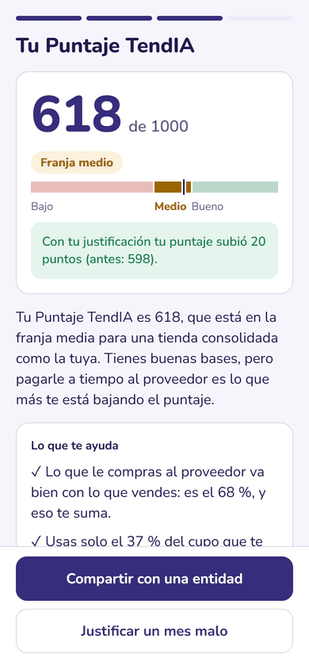<br><sub><b>T7</b> · Puntaje sobre 1000 con su franja</sub></td>
    <td align="center">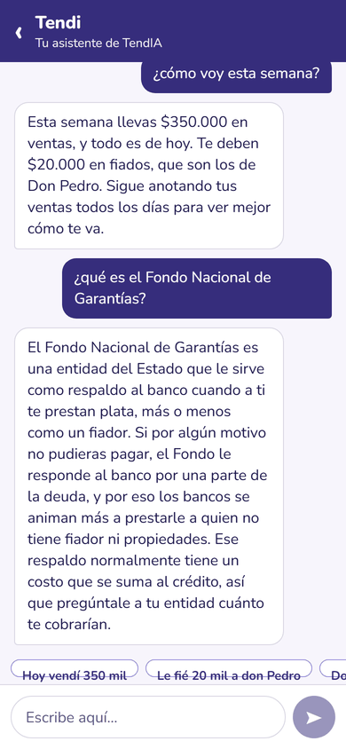<br><sub><b>Tendi</b> · asistente con Claude</sub></td>
    <td align="center">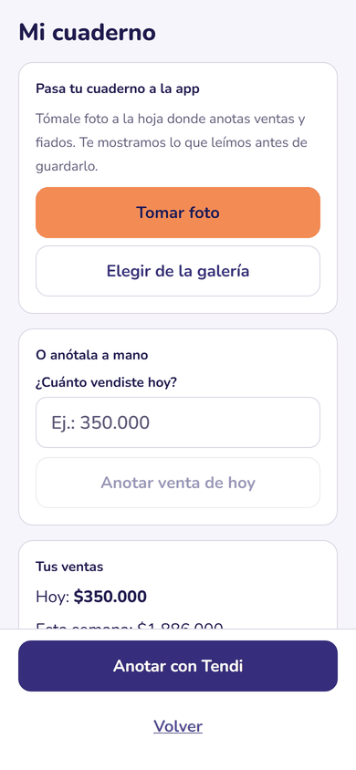<br><sub><b>Mi cuaderno</b> · foto, a mano o con Tendi</sub></td>
    <td align="center">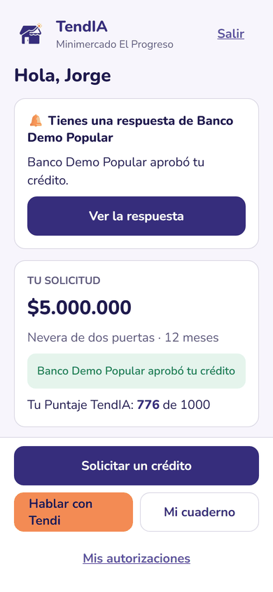<br><sub><b>T11</b> · aviso de la decisión</sub></td>
  </tr>
  <tr>
    <td align="center">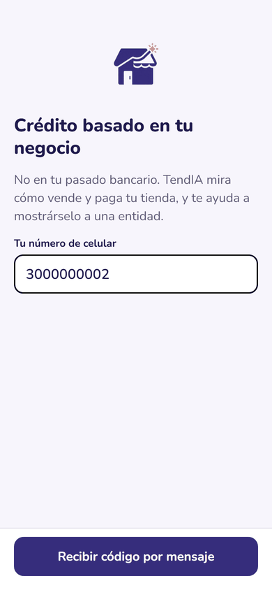<br><sub><b>Ingreso</b> · celular y código</sub></td>
    <td align="center">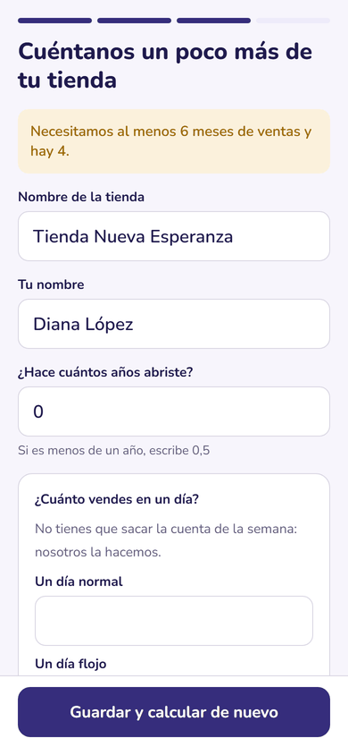<br><sub><b>T5</b> · día normal y día flojo</sub></td>
    <td align="center">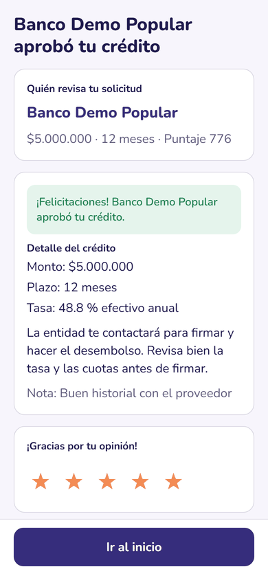<br><sub><b>T12</b> · aprobado con monto, plazo y tasa</sub></td>
    <td align="center">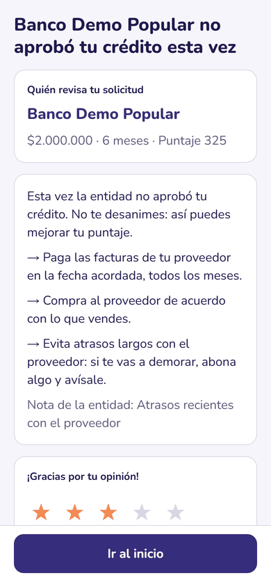<br><sub><b>T13</b> · rechazo con consejos</sub></td>
  </tr>
</table>

<details>
<summary><b>Leer el cuaderno con una foto</b> (Claude con visión)</summary>
<br>
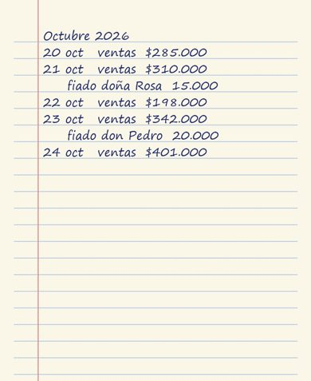

Claude leyó esta hoja así, y nada se guardó hasta que el tendero confirmó:

| Fecha  | Ventas   | Fiados            |
| ------ | -------- | ----------------- |
| 20 oct | $285.000 | —                 |
| 21 oct | $310.000 | doña Rosa $15.000 |
| 22 oct | $198.000 | —                 |
| 23 oct | $342.000 | don Pedro $20.000 |
| 24 oct | $401.000 | —                 |

</details>

### Portal del aliado

<p align="center">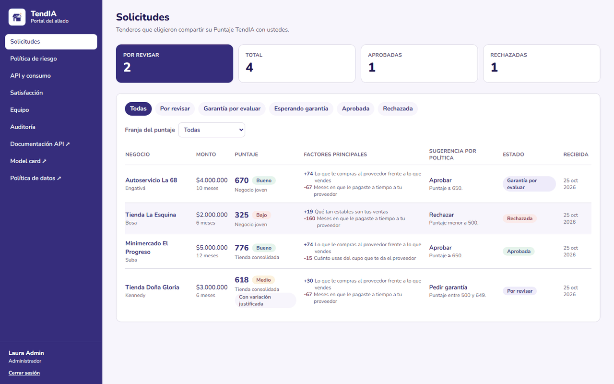<br><sub><b>A1</b> · Bandeja con puntaje, franja, segmento, factores principales y sugerencia según la política</sub></p>

<p align="center">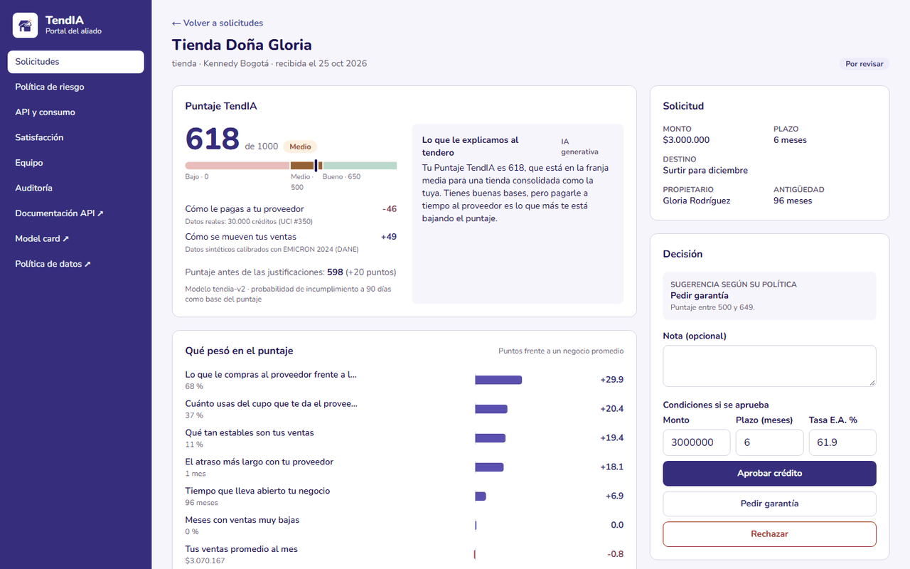<br><sub><b>A2</b> · Qué pesó en el puntaje, explicación con IA y condiciones de aprobación con la tasa real del mercado</sub></p>

<details>
<summary><b>Ver la solicitud completa</b>: variación con evidencia, indicadores, segmento DANE, tasas de la Superfinanciera y pagos al proveedor</summary>
<p align="center">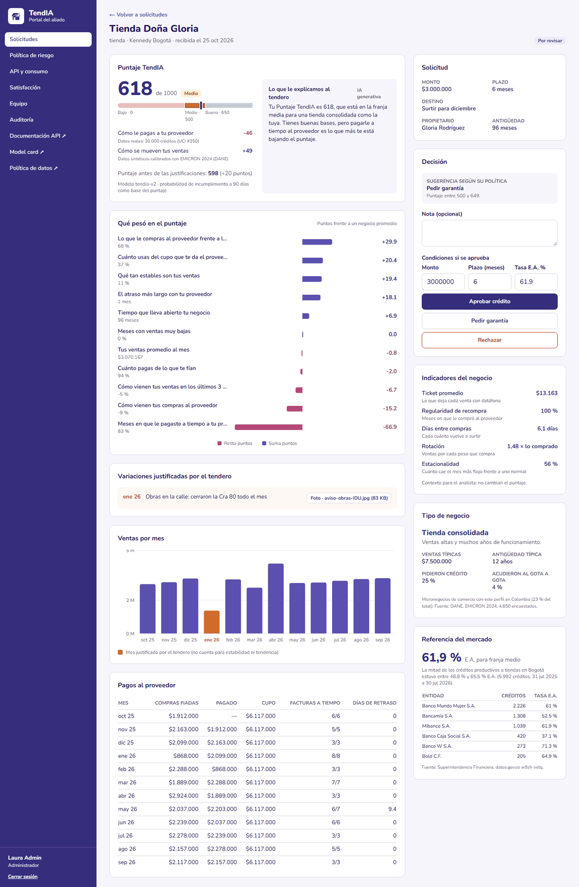</p>
</details>

<table>
  <tr>
    <td>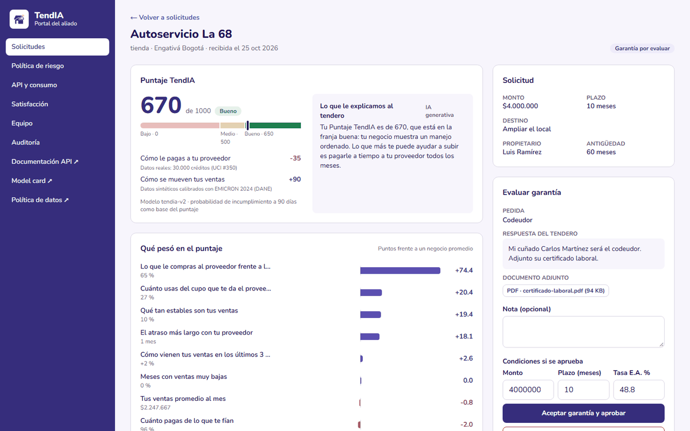<br><sub><b>A3</b> · Garantía con el documento que adjuntó el tendero</sub></td>
    <td>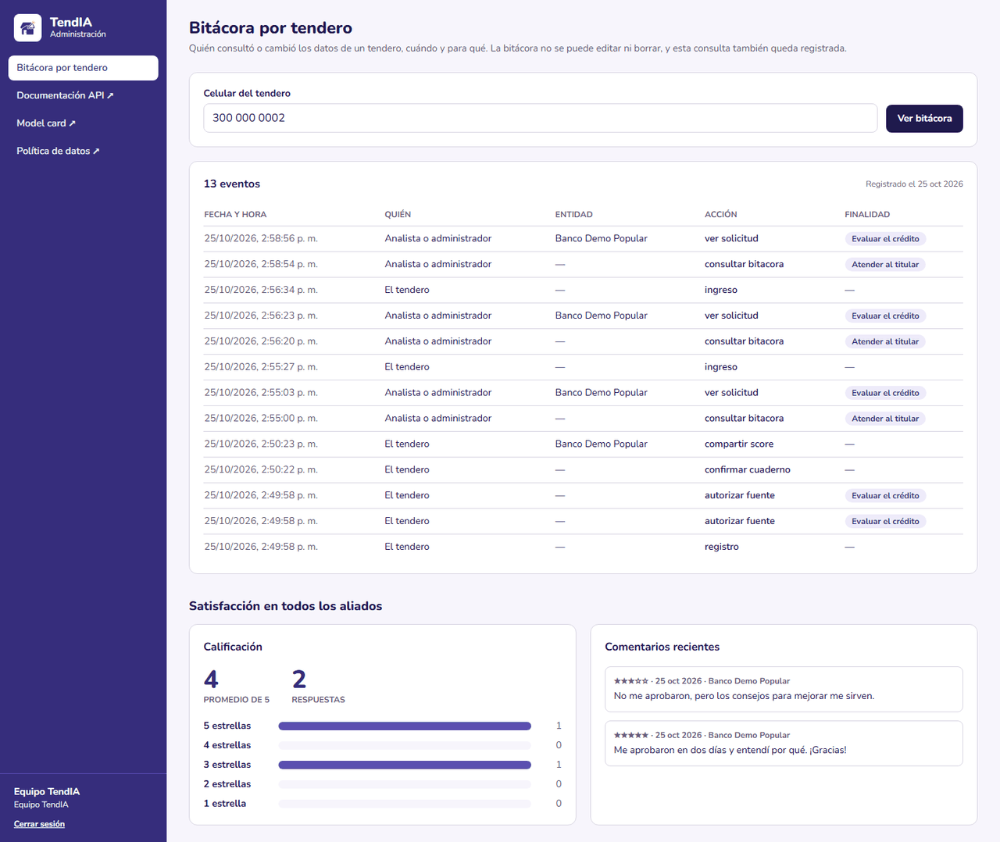<br><sub><b>Equipo TendIA</b> · quién vio los datos de un tendero, cuándo y para qué</sub></td>
  </tr>
  <tr>
    <td>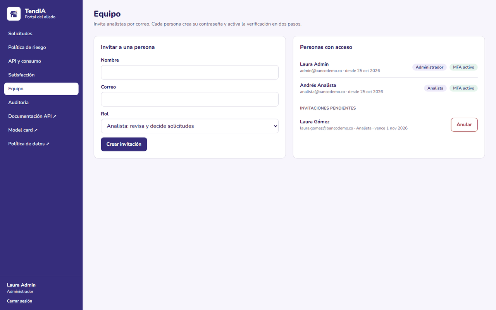<br><sub><b>Equipo</b> · invitar analistas por correo</sub></td>
    <td>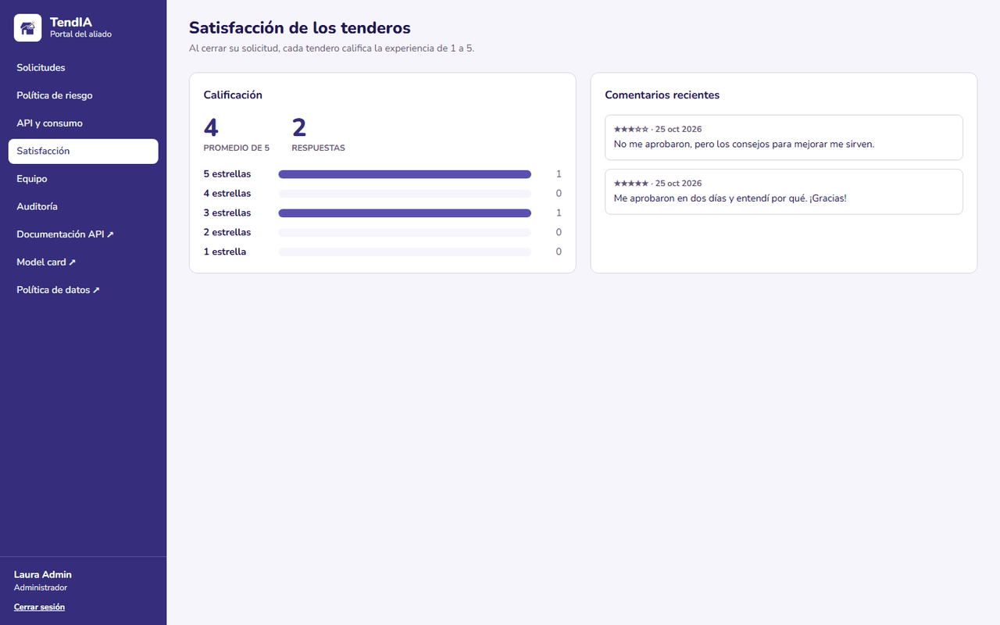<br><sub><b>Satisfacción</b> · calificación de los tenderos</sub></td>
  </tr>
  <tr>
    <td>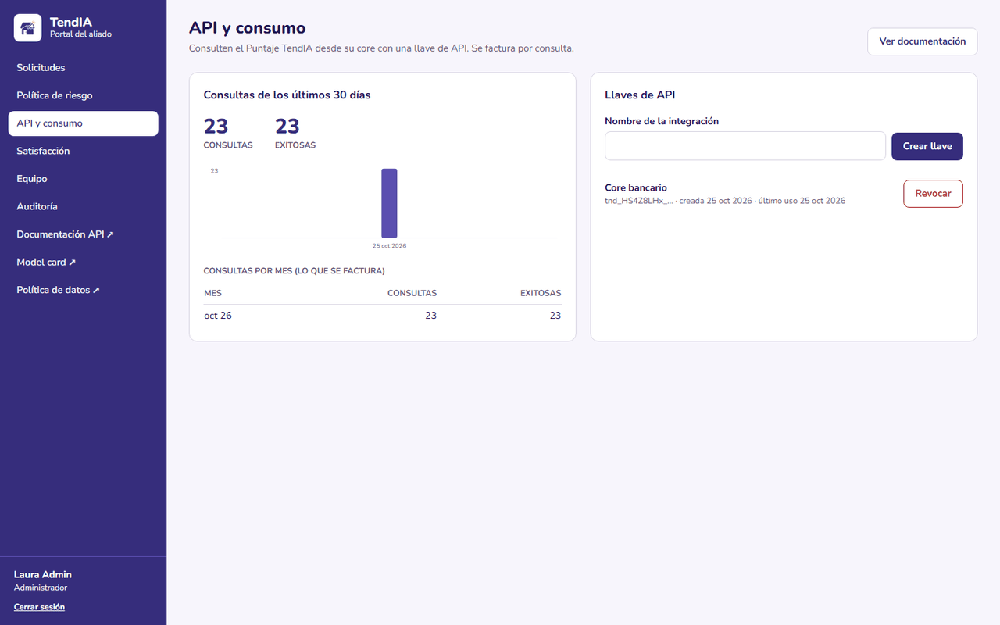<br><sub><b>API y consumo</b> · llaves y consultas por mes</sub></td>
    <td>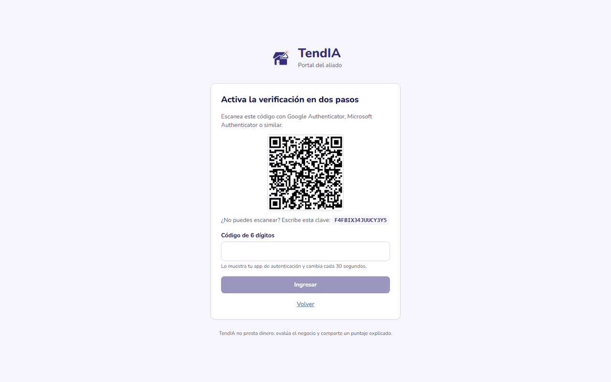<br><sub><b>MFA</b> · enrolamiento obligatorio en el primer ingreso</sub></td>
  </tr>
</table>

## 🧭 Cómo funciona

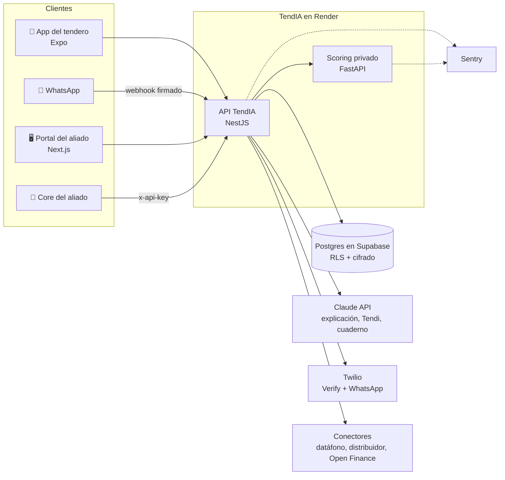

| Pieza                                  | Qué es                                                                                                 | Stack                                |
| -------------------------------------- | ------------------------------------------------------------------------------------------------------ | ------------------------------------ |
| [`apps/mobile`](apps/mobile)           | App del tendero (T1 a T13), Tendi y Mi cuaderno                                                        | Expo SDK 58, Expo Router, TypeScript |
| [`apps/portal`](apps/portal)           | Portal del aliado (A1 a A4), política, API, equipo, satisfacción, auditoría y administración de TendIA | Next.js 15, Tailwind                 |
| [`services/api`](services/api)         | Identidad, consentimientos, solicitudes, conectores, asistente, WhatsApp y API pública                 | NestJS 11, Prisma, Postgres          |
| [`services/scoring`](services/scoring) | Motor interpretable (dos scorecards WoE), segmentación y referencias de mercado                        | Python 3.12, FastAPI, scikit-learn   |
| [`packages/tokens`](packages/tokens)   | Paleta y tipografía de marca, con pruebas de contraste WCAG                                            | TypeScript                           |
| [`docs`](docs)                         | ADR, modelo de datos, model card, datos, plan de pruebas, legal, seguridad, demo                       | Markdown                             |

### El recorrido de una solicitud

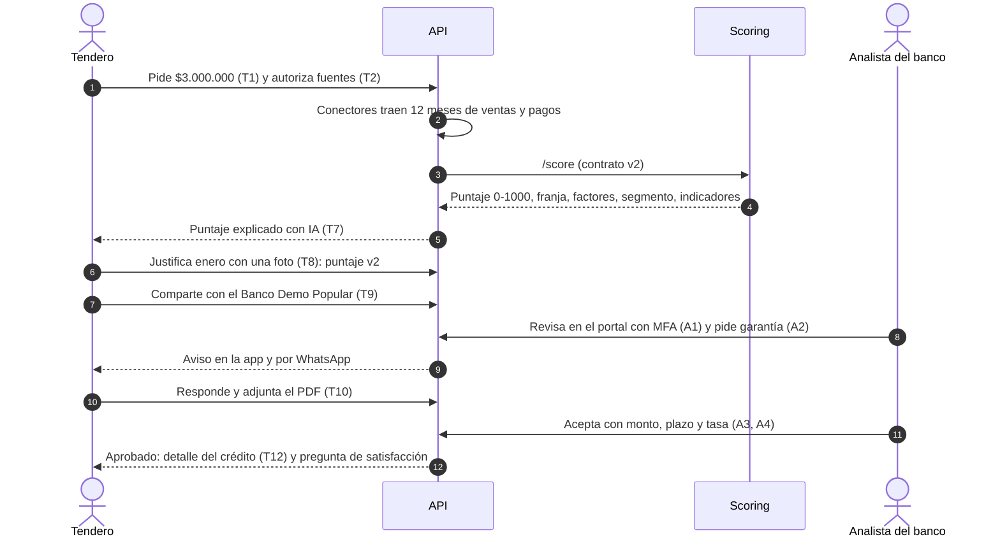

## 📊 Modelo y datos reales

El modelo `tendia-v2` es un **scorecard interpretable** (WoE + regresión logística) con dos componentes, en una escala **0-1000 con tres franjas**: **Bajo** (0-499), **Medio** (500-649) y **Bueno** (650-1000).

| Componente                                    | Peso | Entrenado con                                                                                              | Holdout                   |
| --------------------------------------------- | ---- | ---------------------------------------------------------------------------------------------------------- | ------------------------- |
| **Pagos al proveedor**                        | 1,0  | [UCI #350](https://archive.ics.uci.edu/dataset/350/default+of+credit+card+clients): 30.000 créditos reales | **AUC 0,741 · Gini 0,48** |
| **Negocio** (ventas, estabilidad, antigüedad) | 0,5  | Sintéticos calibrados con [EMICRON 2024 (DANE)](https://microdatos.dane.gov.co/index.php/catalog/875)      | AUC 0,734 (sintético)     |

- **Segmentación real:** KMeans sobre **20.488 micronegocios de comercio** de EMICRON (consolidada, tradicional, joven, subsistencia), con cifras reales de cada segmento: ventas típicas, cuántos pidieron crédito, cuántos acudieron al gota a gota.
- **Tasas reales:** **5.992 créditos productivos** a tiendas de Bogotá de la [Superfinanciera](https://www.datos.gov.co/d/w9zh-vetq) (p25 48,8 %, mediana 61,9 %, p75 65,5 % E.A.), por entidad. El analista las ve al aprobar y el tendero en su puntaje.
- **Indicadores del negocio:** ticket promedio, regularidad de recompra, días entre compras, rotación y estacionalidad. Contexto para el analista; no cambian el puntaje.
- **Explicable por diseño:** cada variable aporta puntos frente a un negocio promedio y la suma es exacta. Un stacking de LR+HGB+RF ganó 0,04 de Gini y no se adoptó, porque no se explica variable por variable (SARC).

Detalle en la [model card](docs/model-card.md), el [diccionario de variables](docs/diccionario-variables.md) y las [fuentes de datos](docs/datos.md).

## 🤖 Inteligencia artificial

TendIA usa **Claude** (Anthropic) en tres lugares. Ninguno calcula ni cambia el puntaje, y todos tienen un plan B sin IA.

| Dónde                              | Qué hace                                                                                                           | Sin `ANTHROPIC_API_KEY`                    |
| ---------------------------------- | ------------------------------------------------------------------------------------------------------------------ | ------------------------------------------ |
| **Explicación del puntaje**        | Pone los factores del modelo en palabras sencillas; se valida contra frases prohibidas ("aprobado", "DataCrédito") | Plantilla                                  |
| **Tendi**, en la app y en WhatsApp | Con _tool use_ anota ventas y fiados, marca pagos, cuenta cómo va la solicitud y explica términos como "FNG"       | Intérprete de reglas ("hoy vendí 350 mil") |
| **Mi cuaderno**                    | Lee la foto de la hoja del cuaderno (visión + salida estructurada); el tendero confirma o corrige antes de guardar | Anotar a mano o con Tendi                  |

Tendi recuerda lo que ya anotó en cada turno, así que no repite registros al leer la conversación. El webhook de WhatsApp valida la firma `X-Twilio-Signature`. Decisiones en [ADR-003](docs/adr/ADR-003-asistente-ia.md).

## 🔐 Seguridad y Ley 1581

- **Consentimiento por fuente** con versión del texto, fecha, finalidad y referencia del conector. Revocarlo **borra** los datos de esa fuente.
- **Celular y cédula cifrados** (AES-256-GCM) con HMAC para buscarlos sin descifrar.
- **MFA obligatorio** para analistas, bloqueo tras 5 intentos e invitaciones de un solo uso.
- **Aislamiento por aliado en dos capas:** la API filtra por el aliado del token y **Postgres lo impone con Row Level Security**, de modo que una consulta que olvide el filtro tampoco ve filas de otro aliado.
- **Bitácora inmutable:** cada lectura guarda quién, cuándo y **para qué**. Un trigger rechaza ediciones y borrados, y el equipo TendIA la consulta por tendero.
- **Sentry sin datos personales:** sin cuerpos, encabezados sensibles, cookies ni usuarios.
- **Revisión OWASP API Top 10** en [docs/security](docs/security/owasp-api-top10.md). `pnpm audit` está limpio.

## 💻 Correr en local

Requisitos: Docker Desktop.

```bash
docker compose up --build
```

| Qué                         | Dónde                                        |
| --------------------------- | -------------------------------------------- |
| Portal del aliado           | http://localhost:3000                        |
| API + documentación OpenAPI | http://localhost:4000/docs                   |
| Scoring                     | http://localhost:8000/docs                   |
| Postgres                    | `localhost:55432` (usuario y clave `tendia`) |

App del tendero: `cd apps/mobile && npm install && npx expo start` (Expo Go en el celular o `w` para web). En un celular físico, crea `apps/mobile/.env` con `EXPO_PUBLIC_API_URL=http://<IP de tu computador>:4000`.

### Probar con tus servicios reales

Copia [`.env.example`](.env.example) como `.env` en la raíz y **quita el `#`** de las líneas que llenes (las comentadas no se leen). `docker compose` lo carga en la API.

| Servicio     | Variables                                      | Cómo probarlo                                                                                                                                                                                                                                                                                                                                                          |
| ------------ | ---------------------------------------------- | ---------------------------------------------------------------------------------------------------------------------------------------------------------------------------------------------------------------------------------------------------------------------------------------------------------------------------------------------------------------------- |
| **Claude**   | `ANTHROPIC_API_KEY`                            | La explicación dice "IA generativa"; en la app, **Hablar con Tendi** → "hoy vendí 350 mil" → **Mi cuaderno** muestra la venta; **Tomar foto** lee una hoja del cuaderno                                                                                                                                                                                                |
| **SMS**      | `TWILIO_ACCOUNT_SID`, `TWILIO_AUTH_TOKEN`      | Entra con tu celular real: **Twilio Verify** envía el código sin que compres un número. En una cuenta de prueba, solo a números verificados. Los celulares de demostración siguen viendo el código en pantalla                                                                                                                                                         |
| **WhatsApp** | Las mismas + `PUBLIC_API_URL`                  | `ngrok http 4000`, pon la URL en `PUBLIC_API_URL` y en Twilio → Messaging → _Try it out_ → WhatsApp sandbox configura _When a message comes in_ = `https://<túnel>/whatsapp/webhook` (POST). Únete al sandbox desde un celular registrado como tendero y escribe "hoy vendí 200 mil" o manda la foto del cuaderno. Las decisiones de la entidad también llegan por ahí |
| **Sentry**   | `SENTRY_DSN` (el DSN del proyecto **Node.js**) | En local solo la API lee `.env`. Un error 500 llega a Sentry con `release=local`; los 4xx no se envían                                                                                                                                                                                                                                                                 |

### Desarrollo sin Docker

Requisitos: Node 22.13+, pnpm 9, Python 3.12+ con [uv](https://docs.astral.sh/uv/).

```bash
pnpm install                                   # portal, API y tokens
docker compose up -d db                        # solo Postgres
cp services/api/.env.example services/api/.env
pnpm --filter @tendia/api exec prisma migrate deploy
cd services/scoring && uv sync && uv run uvicorn tendia_scoring.app:app --port 8000   # terminal 1
pnpm --filter @tendia/api dev                  # terminal 2
pnpm --filter @tendia/portal dev               # terminal 3
cd apps/mobile && npm install && npx expo start  # terminal 4
```

### Pruebas

| Pieza   | Comando                                                                                                                   | Qué cubre                                                                                                     | Resultado              |
| ------- | ------------------------------------------------------------------------------------------------------------------------- | ------------------------------------------------------------------------------------------------------------- | ---------------------- |
| Scoring | `cd services/scoring && uv run pytest`                                                                                    | Variables, scorecard, indicadores, contrato `/score` v2                                                       | **41 pruebas · 91 %**  |
| API     | `pnpm --filter @tendia/api test`                                                                                          | Flujo T1 → T13, aislamiento y RLS, Ley 1581, invitaciones, adjuntos, asistente, OTP con Twilio Verify, Sentry | **101 pruebas · 90 %** |
| Portal  | `pnpm --filter @tendia/portal test` y `test:e2e`                                                                          | Formatos y flujo feliz con Playwright (MFA → aprobar con la tasa del mercado)                                 | ✅                     |
| App     | `npm run lint && npx tsc --noEmit` en `apps/mobile`; [`.maestro/flujo-feliz.yaml`](apps/mobile/.maestro/flujo-feliz.yaml) | Tipos, lint y flujo feliz con Maestro                                                                         | ✅                     |
| Tokens  | `pnpm --filter @tendia/tokens test`                                                                                       | Contraste WCAG AA de la paleta                                                                                | ✅                     |

Las pruebas de la API necesitan Postgres (`tendia_test`) y el scoring corriendo. Detalle en el [plan de pruebas](docs/test-plan.md).

## ☁️ Despliegue

[`render.yaml`](render.yaml) define los tres servicios. Render despliega al fusionar a `main`, y la API aplica las migraciones al arrancar.

| Servicio         | Tipo                             | URL                                |
| ---------------- | -------------------------------- | ---------------------------------- |
| `tendia-portal`  | Web                              | https://tendia-portal.onrender.com |
| `tendia-api`     | Web                              | https://tendia-api.onrender.com    |
| `tendia-scoring` | Privado                          | Solo dentro de la red de Render    |
| Base de datos    | Supabase (Postgres administrado) | Cadena en `DATABASE_URL`           |

Variables, Sentry con la versión del commit (`RENDER_GIT_COMMIT`), Twilio y WhatsApp en [docs/deploy.md](docs/deploy.md).

## 📚 Documentación

| Documento                                                                                                             | De qué trata                                                  |
| --------------------------------------------------------------------------------------------------------------------- | ------------------------------------------------------------- |
| [ADR-001 Autenticación](docs/adr/ADR-001-autenticacion.md)                                                            | JWT propios, OTP con Twilio Verify, MFA, invitaciones y roles |
| [ADR-002 Arquitectura](docs/adr/ADR-002-arquitectura.md)                                                              | C4 nivel 2 y por qué esta división                            |
| [ADR-003 Asistente de IA](docs/adr/ADR-003-asistente-ia.md)                                                           | Tendi, WhatsApp y lectura del cuaderno                        |
| [Modelo de datos](docs/data-model.md)                                                                                 | Diagrama entidad-relación, estados y protección de datos      |
| [Model card](docs/model-card.md) · [Diccionario de variables](docs/diccionario-variables.md) · [Datos](docs/datos.md) | Cómo se entrena, con qué, qué tan bien funciona y sus límites |
| [Plan de pruebas](docs/test-plan.md)                                                                                  | Pirámide, cobertura y casos que no se pueden romper           |
| [OWASP API Top 10](docs/security/owasp-api-top10.md)                                                                  | Revisión de seguridad                                         |
| [Política de datos](docs/legal/politica-tratamiento-datos.md) · [Aviso de privacidad](docs/legal/aviso-privacidad.md) | Ley 1581                                                      |
| [Guion de demo](docs/demo.md) · [Prueba de usabilidad](docs/usabilidad.md)                                            | Entrega final y validación con tenderos                       |
| [Despliegue](docs/deploy.md) · [Marca](docs/brand.md)                                                                 | Ambientes, secretos, observabilidad y paleta                  |

## 🤝 Cómo trabajamos

- Ramas `feature/TND-XXX-descripcion`, [Conventional Commits](https://www.conventionalcommits.org/es/v1.0.0/) y PR obligatorio a `main` con al menos una aprobación.
- [CI](.github/workflows/ci.yml) corre solo las piezas que cambiaron; el check `ci-ok` es obligatorio para fusionar. Dependabot propone las actualizaciones.
- La Definition of Done está en la plantilla de PR. Las historias viven en los issues (`TND-XXX`) agrupados en épicas E0 a E8.

## 👥 Equipo

| Persona                                                                                           | Rol                         |
| ------------------------------------------------------------------------------------------------- | --------------------------- |
| Andersson David Sánchez Méndez ([@AnderssonProgramming](https://github.com/AnderssonProgramming)) | QA & Data/ML Lead           |
| Cristian Santiago Pedraza Rodríguez ([@cris-eci](https://github.com/cris-eci))                    | Backend Developer           |
| David Santiago Villadiego Médicis ([@Krayangel](https://github.com/Krayangel))                    | Data Scientist              |
| David Stiven Sarria Arcila ([@DASarria](https://github.com/DASarria))                             | Product & Business Strategy |
| Juan Esteban Lozano Cárdenas ([@juanLozano-2004](https://github.com/juanLozano-2004))             | UX/UI & Wireframes          |
| Raquel Iveth Selma Ayala ([@RaquelSAyala](https://github.com/RaquelSAyala))                       | Documentation & QA          |

<p align="center"><sub>Proyecto de IETI · Escuela Colombiana de Ingeniería Julio Garavito · 2026</sub></p>
