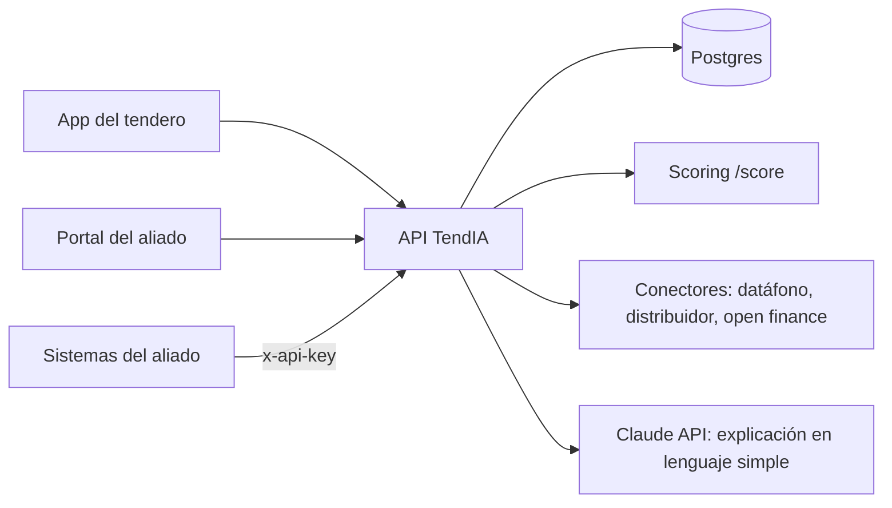

<p align="center"></p>

# TendIA

**Crédito basado en tu negocio, no en tu pasado bancario.**

TendIA convierte la actividad real de una tienda de barrio (ventas con datáfono, pagos al distribuidor, lo que el tendero anota en su cuaderno) en un **Puntaje TendIA de 0 a 100 explicado**, que el tendero ve, puede justificar y decide con qué entidad compartir. TendIA no presta dinero: vende la evaluación de riesgo a bancos, fintechs, microfinancieras y distribuidores (B2B2C).

## Qué hay en este repo

| Pieza                                  | Qué es                                                              | Stack                                |
| -------------------------------------- | ------------------------------------------------------------------- | ------------------------------------ |
| [`apps/mobile`](apps/mobile)           | App del tendero (T1 a T13)                                          | Expo SDK 58, Expo Router, TypeScript |
| [`apps/portal`](apps/portal)           | Portal del aliado (A1 a A4), política, API y auditoría              | Next.js 15, Tailwind                 |
| [`services/api`](services/api)         | Identidad, consentimientos, solicitudes, conectores, API pública    | NestJS, Prisma, Postgres             |
| [`services/scoring`](services/scoring) | Motor de scoring interpretable (scorecard WoE)                      | Python 3.12, FastAPI, scikit-learn   |
| [`packages/tokens`](packages/tokens)   | Paleta y tipografía de marca, con pruebas de contraste              | TypeScript                           |
| [`docs`](docs)                         | ADR, modelo de datos, plan de pruebas, model card, legal, seguridad | Markdown                             |



## Arrancar en 2 minutos

Requisitos: Docker Desktop.

```bash
docker compose up --build
```

| Qué                         | Dónde                                        |
| --------------------------- | -------------------------------------------- |
| Portal del aliado           | http://localhost:3000                        |
| API + documentación OpenAPI | http://localhost:4000/docs                   |
| Scoring                     | http://localhost:8000/docs                   |
| Postgres                    | `localhost:55432` (usuario y clave `tendia`) |

**Cuentas de demostración** (solo local y staging; contraseña `TendIA-demo-2026!`):

- `admin@bancodemo.co` (administrador del Banco Demo Popular) y `analista@bancodemo.co`
- `admin@microdemo.co` (Microcrédito Demo)

El primer ingreso pide activar la verificación en dos pasos: escanea el QR con Google Authenticator o similar.

**Celulares de demostración** para la app (el código OTP aparece en pantalla en modo de prueba):

| Celular      | Perfil simulado       | Para mostrar                              |
| ------------ | --------------------- | ----------------------------------------- |
| 300 000 0001 | Buen negocio          | Puntaje alto, aprobación                  |
| 300 000 0002 | Caída fuerte en enero | Justificar una variación (T8)             |
| 300 000 0003 | Negocio riesgoso      | Rechazo con consejos para mejorar         |
| 300 000 0004 | Negocio nuevo         | Datos incompletos → completar a mano (T5) |

Cualquier otro celular que empiece por 3 genera un negocio simulado distinto pero reproducible.

## Desarrollo

Requisitos: Node 22.13+, pnpm 9, Python 3.12+ con [uv](https://docs.astral.sh/uv/), Docker.

```bash
pnpm install                                   # portal, API y tokens
docker compose up -d db                        # solo Postgres
cp services/api/.env.example services/api/.env
pnpm --filter @tendia/api exec prisma migrate deploy
cd services/scoring && uv sync && uv run uvicorn tendia_scoring.app:app --port 8000   # terminal 1
pnpm --filter @tendia/api dev                  # terminal 2
pnpm --filter @tendia/portal dev               # terminal 3
cd apps/mobile && npm install && npx expo start  # terminal 4 (Expo Go o emulador Android)
```

En un celular físico con Expo Go, crea `apps/mobile/.env` con `EXPO_PUBLIC_API_URL=http://<IP de tu computador>:4000`.

### Pruebas

| Pieza   | Comando                                                                           | Qué cubre                                                                                        |
| ------- | --------------------------------------------------------------------------------- | ------------------------------------------------------------------------------------------------ |
| Scoring | `cd services/scoring && uv run pytest`                                            | Variables, scorecard, contrato v1. Cobertura ≥ 70 %                                              |
| API     | `pnpm --filter @tendia/api test`                                                  | Unitarias + integración del flujo completo, aislamiento, Ley 1581, API pública. Cobertura ≥ 70 % |
| Portal  | `pnpm --filter @tendia/portal test` y `test:e2e`                                  | Formatos y flujo feliz con Playwright                                                            |
| App     | `npm run lint && npm run typecheck` en `apps/mobile`; `.maestro/flujo-feliz.yaml` | Flujo feliz con Maestro                                                                          |
| Tokens  | `pnpm --filter @tendia/tokens test`                                               | Contraste WCAG AA de la paleta                                                                   |

Las pruebas de la API necesitan Postgres (`tendia_test`) y el scoring corriendo. Detalle en [docs/test-plan.md](docs/test-plan.md).

## Cómo trabajamos

- Ramas `feature/TND-XXX-descripcion`, [Conventional Commits](https://www.conventionalcommits.org/es/v1.0.0/) y PR obligatorio a `main` con al menos una aprobación.
- CI ([`.github/workflows/ci.yml`](.github/workflows/ci.yml)) corre solo las piezas que cambiaron; el check `ci-ok` es obligatorio para fusionar.
- La Definition of Done está en la plantilla de PR.
- Decisiones de arquitectura en [`docs/adr`](docs/adr). Despliegue en [docs/deploy.md](docs/deploy.md).

## Equipo

| Persona                                                | Rol                         |
| ------------------------------------------------------ | --------------------------- |
| Andersson David Sánchez Méndez (@AnderssonProgramming) | QA & Data/ML Lead           |
| Cristian Santiago Pedraza Rodríguez (@cris-eci)        | Backend Developer           |
| David Santiago Villadiego Médicis (@Krayangel)         | Data Scientist              |
| David Stiven Sarria Arcila (@DASarria)                 | Product & Business Strategy |
| Juan Esteban Lozano Cárdenas (@juanLozano-2004)        | UX/UI & Wireframes          |
| Raquel Iveth Selma Ayala (@RaquelSAyala)               | Documentation & QA          |

Proyecto de IETI, Escuela Colombiana de Ingeniería Julio Garavito.
