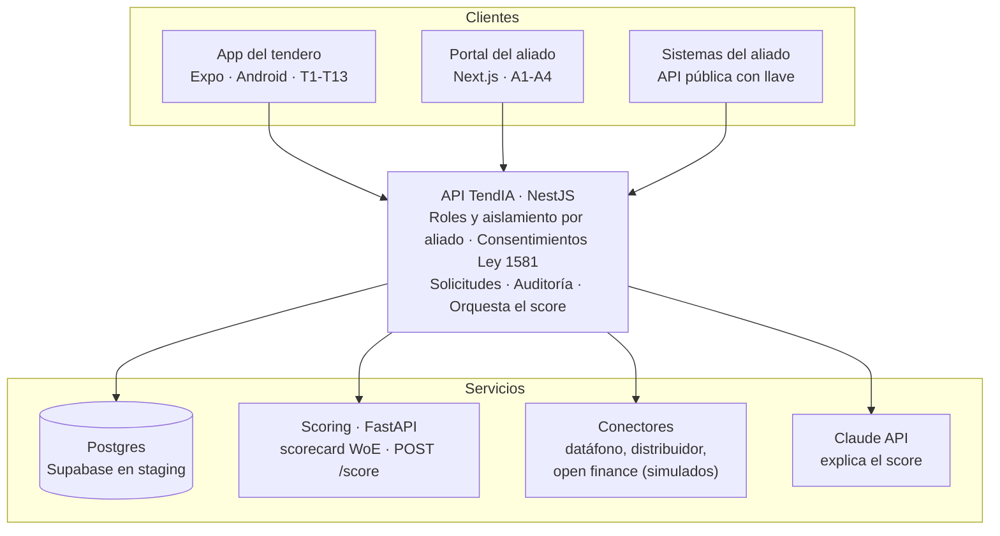

# ADR-002: Arquitectura del MVP

- **Estado:** aceptada (pendiente de revisión del equipo)
- **Fecha:** 2026-10-23
- **Historia:** TND-003

## Contexto

En menos de 6 semanas el MVP debe mostrar el flujo completo tendero → score explicado → decisión del aliado. Lo construye un equipo de 6 con perfiles de backend, datos, UX y negocio. El modelo de riesgo debe poder auditarse (SARC, Superintendencia Financiera) y los datos personales deben tratarse según la Ley 1581.

## Decisión

Monorepo con cuatro piezas y una sola puerta de entrada a los datos.

| Decisión                                                | Alternativa descartada                  | Por qué                                                                                        |
| ------------------------------------------------------- | --------------------------------------- | ---------------------------------------------------------------------------------------------- |
| TypeScript en app, portal y API; Python solo en scoring | Todo en Python                          | Tipos compartidos con los clientes; Python es el estándar para el modelo                       |
| NestJS en la API                                        | FastAPI                                 | Guards por rol, módulos y OpenAPI listos para la API pública                                   |
| Prisma + Postgres                                       | Supabase SDK directo desde los clientes | La API es la única puerta: un solo lugar para el consentimiento, el aislamiento y la auditoría |
| Scorecard WoE + regresión logística                     | XGBoost desde el inicio                 | Interpretable y auditable (SARC). XGBoost se probó y no superó al baseline (ver model card)    |
| La IA solo explica, nunca calcula                       | IA que genera el puntaje                | El puntaje debe ser reproducible y auditable                                                   |
| Contrato `/score` v1 versionado                         | Llamadas sin contrato                   | Las pruebas de contrato (TND-071) fallan si un campo cambia sin versión nueva                  |
| Expo (Android primero)                                  | Apps nativas                            | Un solo código; los tenderos usan Android                                                      |
| `pnpm` + Turborepo; la app móvil con npm propio         | Todo en pnpm                            | Metro funciona mejor sin el enlazado aislado de pnpm                                           |

## Consecuencias

- Los clientes nunca hablan con la base de datos, el scoring ni la IA directamente.
- El scoring no tiene estado ni datos personales: recibe series mensuales y devuelve el puntaje.
- Los conectores reales (Bold, Treinta, Belvo, distribuidores) implementan la interfaz `Conector` sin cambiar el resto del sistema.
- Staging en Render (`render.yaml`): el scoring corre como servicio privado y la API y el portal como servicios web.
