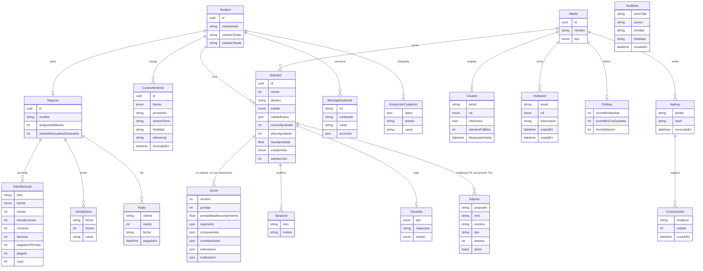
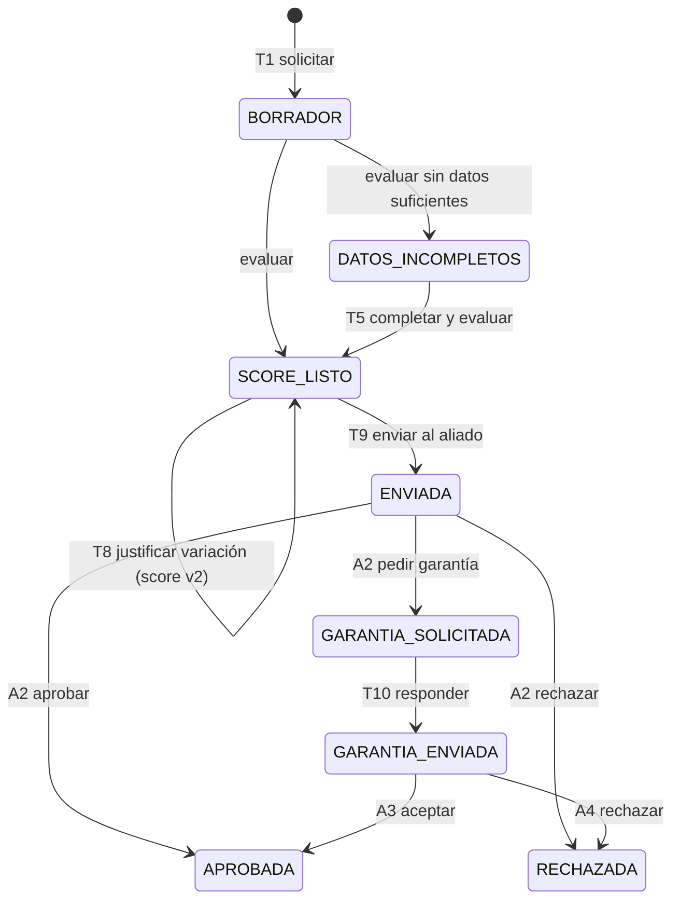

# Modelo de datos

Fuente de verdad: [`services/api/prisma/schema.prisma`](../services/api/prisma/schema.prisma). Las migraciones están en `services/api/prisma/migrations` y corren en limpio con `prisma migrate deploy` sobre un Postgres nuevo, incluido el de un proyecto Supabase.

## Estados de una solicitud

## Decisiones de protección de datos

- **Celular:** se guarda cifrado (AES-256-GCM) junto con un HMAC para buscarlo sin descifrarlo. La cédula también se cifra.
- **Consentimiento:** uno por fuente, con versión del texto aceptado. Revocarlo borra los `DatoMensual` de esa fuente.
- **Consentimiento:** guarda además la finalidad y la referencia que devolvió el conector al autorizar (TND-020).
- **Aliados (TND-012):** solo ven solicitudes que el tendero les envió (`aliadoId` + estados visibles). Una solicitud de otro aliado responde 404. Además, **Postgres lo impone con Row Level Security**: el portal lee dentro de una transacción con el rol `tendia_aliado` y `app.aliado_id`, y las políticas de `Solicitud`, `Score`, `Variacion`, `Garantia`, `Adjunto`, `Tendero`, `Negocio`, `DatoMensual` y `Politica` solo devuelven filas de ese aliado, aunque una consulta olvide el filtro. Todas las tablas tienen RLS activo, así que los roles `anon` y `authenticated` de Supabase no leen nada.
- **Roles:** `TENDERO` (app), `ANALISTA` y `ADMIN_ALIADO` (portal de cada aliado) y `ADMIN_TENDIA` (equipo de TendIA, sin aliado: bitácora por tendero y satisfacción global).
- **Auditoría (TND-022):** guarda IDs, acción y **finalidad**, nunca datos personales. Un trigger rechaza `UPDATE` y `DELETE`: nadie la edita desde la aplicación.
- **Adjuntos:** máximo 5 MB, solo JPG, PNG, WEBP o PDF, con la firma del archivo verificada. Se descargan solo con sesión del aliado que recibió la solicitud, y cada descarga queda en la bitácora.
- **Asistente:** `MensajeAsistente.acciones` guarda lo que Tendi anotó en cada turno, para que no lo vuelva a anotar al leer el historial.
