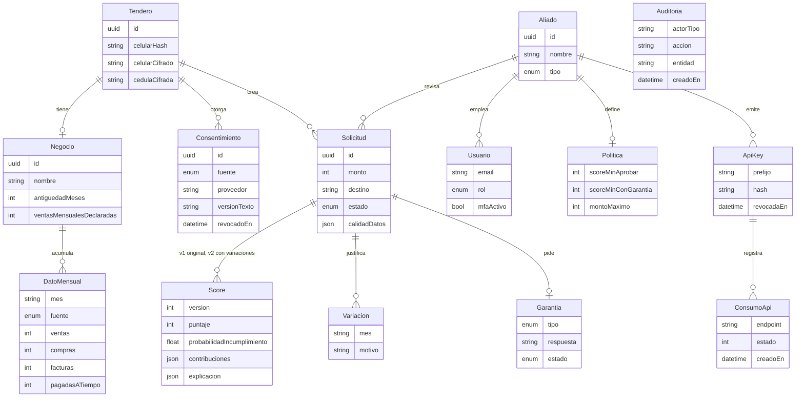
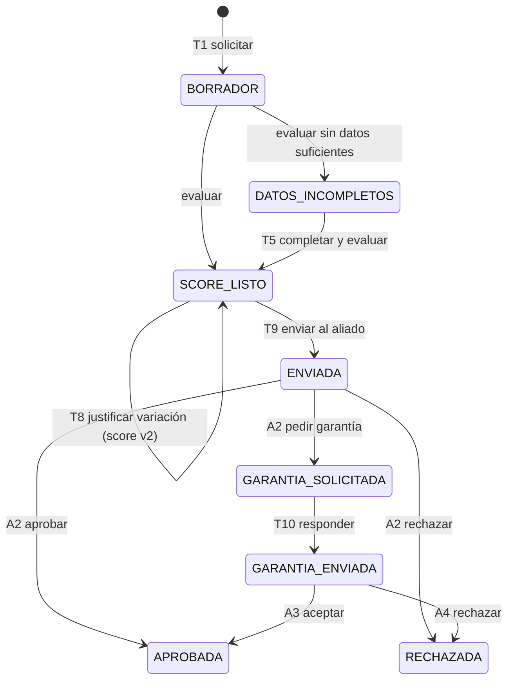

# Modelo de datos

Fuente de verdad: [`services/api/prisma/schema.prisma`](../services/api/prisma/schema.prisma). Las migraciones están en `services/api/prisma/migrations` y corren en limpio con `prisma migrate deploy` sobre un Postgres nuevo, incluido el de un proyecto Supabase.

## Estados de una solicitud

## Decisiones de protección de datos

- **Celular:** se guarda cifrado (AES-256-GCM) junto con un HMAC para buscarlo sin descifrarlo. La cédula también se cifra.
- **Consentimiento:** uno por fuente, con versión del texto aceptado. Revocarlo borra los `DatoMensual` de esa fuente.
- **Aliados:** solo ven solicitudes que el tendero les envió (`aliadoId` + estados visibles). Una solicitud de otro aliado responde 404.
- **Auditoría:** guarda IDs y acciones, nunca datos personales.
