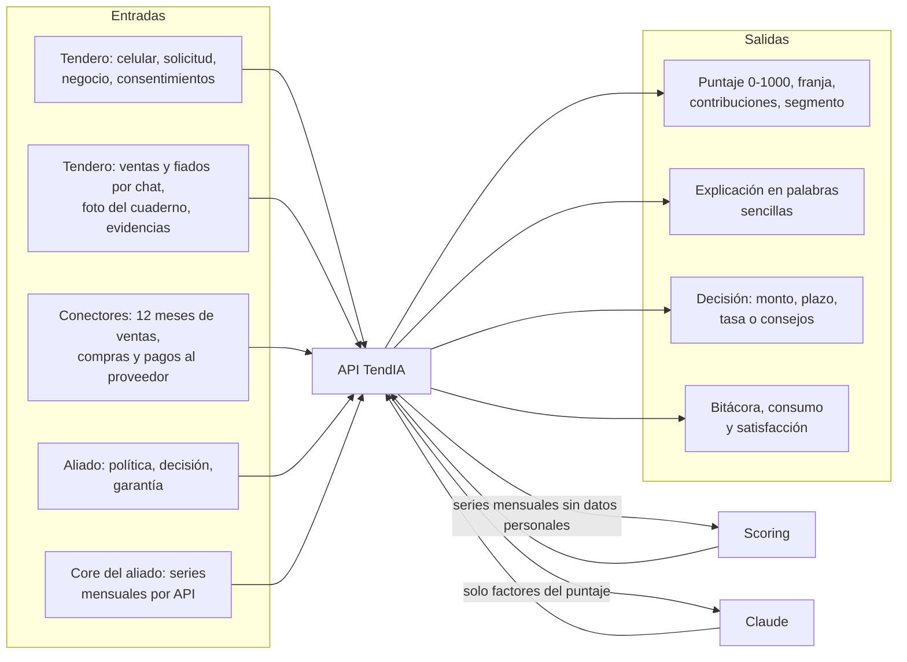

# Datos de entrada y salida

Qué entra a TendIA, qué sale y quién lo produce. Las variables del modelo están en el [diccionario de variables](diccionario-variables.md), las fuentes de entrenamiento en [datos.md](datos.md) y las tablas en el [modelo de datos](data-model.md).



## Entradas

### Del tendero (app y WhatsApp)

| Dato                                     | Formato y validación                                                                         | Dónde se guarda                                                | Protección                                                      |
| ---------------------------------------- | -------------------------------------------------------------------------------------------- | -------------------------------------------------------------- | --------------------------------------------------------------- |
| Celular                                  | 10 dígitos colombianos                                                                       | `Tendero.celularCifrado` y `celularHash`                       | AES-256-GCM y HMAC para buscarlo sin descifrarlo                |
| Código de ingreso                        | 6 dígitos, vence en 5 min, 5 intentos                                                        | `OtpCodigo.codigoHash`                                         | Solo el hash; Twilio Verify lo envía                            |
| Solicitud (T1)                           | Monto entero de $200.000 a $50.000.000, destino de 3 a 200 caracteres, plazo de 1 a 36 meses | `Solicitud`                                                    | —                                                               |
| Negocio (T5)                             | Nombre, tipo, barrio, ciudad, antigüedad de 0 a 1.200 meses, ventas declaradas               | `Negocio`                                                      | —                                                               |
| Ventas de un día normal y uno flojo (T5) | Enteros en pesos                                                                             | `DatoMensual` con fuente `MANUAL`                              | —                                                               |
| Consentimiento (T2)                      | Fuente (`DATAFONO`, `DISTRIBUIDOR`, `OPEN_FINANCE`) y proveedor                              | `Consentimiento` con versión del texto, finalidad y referencia | Revocarlo borra los `DatoMensual` de esa fuente                 |
| Variación justificada (T8)               | Mes `YYYY-MM` y motivo de 3 a 280 caracteres, con foto opcional                              | `Variacion` y `Adjunto`                                        | —                                                               |
| Respuesta a la garantía (T10)            | Texto y documento                                                                            | `Garantia.respuesta` y `Adjunto`                               | Solo lo descarga el aliado que la pidió, y queda en la bitácora |
| Adjuntos                                 | JPG, PNG, WEBP o PDF de hasta 3 MB, firma del archivo verificada                             | `Adjunto.datos` (bytes en Postgres)                            | —                                                               |
| Mensajes a Tendi                         | Texto libre, 30 por minuto                                                                   | `MensajeAsistente`                                             | No se envían celular ni nombre a Claude                         |
| Venta del día y fiados                   | Monto y fecha; fiado con nombre del cliente                                                  | `VentaDiaria`, `Fiado`                                         | —                                                               |
| Foto del cuaderno                        | Imagen de hasta 3 MB, 10 por minuto                                                          | Solo la lectura en `ExtraccionCuaderno`, no la imagen          | El tendero confirma antes de guardar                            |
| Calificación                             | 1 a 5 y comentario                                                                           | `Solicitud.satisfaccion`                                       | —                                                               |

### De los conectores

Cada conector implementa la interfaz `Conector` (`autorizar`, `recolectar`, `estado`) y entrega registros mensuales. Solo se llaman las fuentes con consentimiento vigente.

| Fuente       | Campos por mes                                                                   | Proveedores previstos     |
| ------------ | -------------------------------------------------------------------------------- | ------------------------- |
| Datáfono     | `ventas`, `transacciones`                                                        | Bold, Treinta             |
| Distribuidor | `compras`, `facturas`, `pagadasATiempo`, `diasRetrasoPromedio`, `pagado`, `cupo` | Distribuidores mayoristas |
| Open Finance | `ventas` (abonos a la cuenta)                                                    | Belvo                     |

Hoy son simulados: generan series con las distribuciones de EMICRON 2024 según un perfil por negocio.

### Del aliado

| Dato               | Formato                                                                                 | Dónde                                                   |
| ------------------ | --------------------------------------------------------------------------------------- | ------------------------------------------------------- |
| Credenciales       | Correo, contraseña y código TOTP                                                        | `Usuario` (hash bcrypt y secreto TOTP)                  |
| Política           | Puntaje mínimo para aprobar, mínimo con garantía y monto máximo                         | `Politica`, versionada                                  |
| Decisión (A2 a A4) | Aprobar con monto, plazo y tasa; rechazar con nota; pedir garantía FNG, codeudor u otra | `Solicitud`, `Garantia`                                 |
| Invitaciones       | Correo, nombre y rol                                                                    | `Invitacion` (solo el hash del enlace, vence en 7 días) |
| Llaves de API      | Nombre                                                                                  | `ApiKey` (prefijo visible y hash)                       |

### Del sistema del aliado: `POST /v1/score`

Cabecera `x-api-key`. El cuerpo sigue el contrato del scoring:

```json
{
  "business": { "business_age_months": 36, "declared_monthly_sales": 9000000 },
  "sales": [{ "month": "2026-09", "amount": 9400000, "source": "datafono", "transactions": 610 }],
  "distributor": [
    {
      "month": "2026-09",
      "purchases": 6800000,
      "invoices": 5,
      "paid_on_time": 5,
      "avg_days_late": 0,
      "paid_amount": 6400000,
      "credit_limit": 9000000
    }
  ],
  "adjustments": [{ "month": "2026-01", "reason": "Obras en la calle" }]
}
```

Hasta 36 meses por serie y 12 ajustes. Un campo desconocido responde 400, porque el contrato no admite campos extra.

## Salidas

### Puntaje (scoring, contrato v2)

| Campo                                             | Qué es                                                                                                                       |
| ------------------------------------------------- | ---------------------------------------------------------------------------------------------------------------------------- |
| `score`                                           | Puntaje de 0 a 1000, o `null` si los datos no alcanzan                                                                       |
| `band`                                            | Franja: bajo (0 a 499), medio (500 a 649) o bueno (650 a 1000)                                                               |
| `probability_default`                             | Probabilidad de incumplimiento a 90 días                                                                                     |
| `components`                                      | Puntos de cada componente: pagos (entrenado con UCI) y negocio                                                               |
| `contributions`, `top_positive`, `top_negative`   | Puntos que suma o resta cada variable frente a un negocio promedio; la suma da el puntaje                                    |
| `segment`                                         | Segmento EMICRON del negocio con sus medianas reales                                                                         |
| `indicators`                                      | Ticket promedio, regularidad de recompra, días entre compras, rotación y estacionalidad; dan contexto y no entran al puntaje |
| `data_quality`                                    | Si los datos alcanzan, meses por fuente y problemas encontrados                                                              |
| `adjusted_months`                                 | Meses justificados que no contaron                                                                                           |
| `contract_version`, `model_version`, `request_id` | Trazabilidad                                                                                                                 |

### Explicación (Claude)

`{ resumen, fortalezas[], aMejorar[] }` en palabras de tendero, y `explicacionFuente` (`ia` o `plantilla`). Claude recibe solo los factores, nunca nombre ni celular. Si su texto promete algo prohibido, como "aprobado", se descarta y se usa la plantilla.

### Para cada usuario

| Salida                                                                                          | Para quién               | Dónde            |
| ----------------------------------------------------------------------------------------------- | ------------------------ | ---------------- |
| Puntaje explicado, lo que ayuda y lo que baja                                                   | Tendero                  | App (T7)         |
| Estado de la solicitud y avisos                                                                 | Tendero                  | App y WhatsApp   |
| Decisión con monto, plazo, tasa o consejos                                                      | Tendero                  | App (T11 a T13)  |
| Bandeja con sugerencia según la política                                                        | Analista                 | Portal (A1)      |
| Detalle variable por variable, segmento, indicadores y tasa de referencia de la Superfinanciera | Analista                 | Portal (A1)      |
| Consumo de la API por mes                                                                       | Administrador del aliado | Portal           |
| Bitácora de accesos                                                                             | Aliado y equipo TendIA   | Portal           |
| Satisfacción                                                                                    | Aliado y equipo TendIA   | Portal           |
| Puntaje con explicación en JSON                                                                 | Core del aliado          | `POST /v1/score` |
| Salud y versión desplegada                                                                      | Operación                | `GET /health`    |

## Datos de entrenamiento

| Fuente                                            | Registros                          | Uso                                                  |
| ------------------------------------------------- | ---------------------------------- | ---------------------------------------------------- |
| UCI #350, Default of Credit Card Clients          | 30.000 créditos reales             | Componente de pagos                                  |
| EMICRON 2024 (DANE)                               | 20.488 micronegocios               | Segmentos y simulación de conectores                 |
| Superintendencia Financiera, créditos productivos | 5.992 créditos a tiendas de Bogotá | Tasas de referencia por franja                       |
| Sintéticos calibrados con EMICRON                 | 12.000 negocios                    | Componente de negocio, mientras no haya pagos reales |

Detalles en [datos.md](datos.md) y en la [model card](model-card.md).
