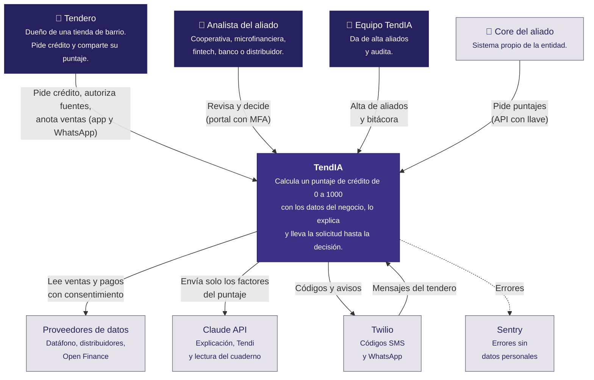
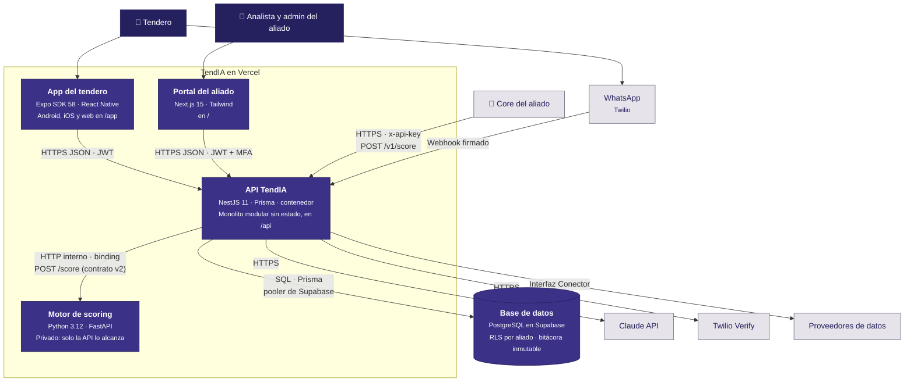
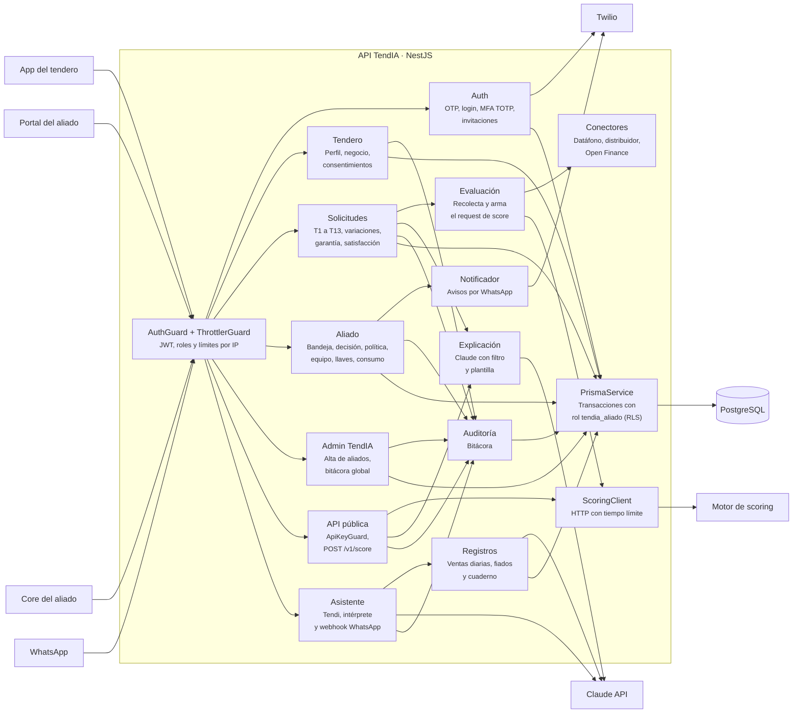
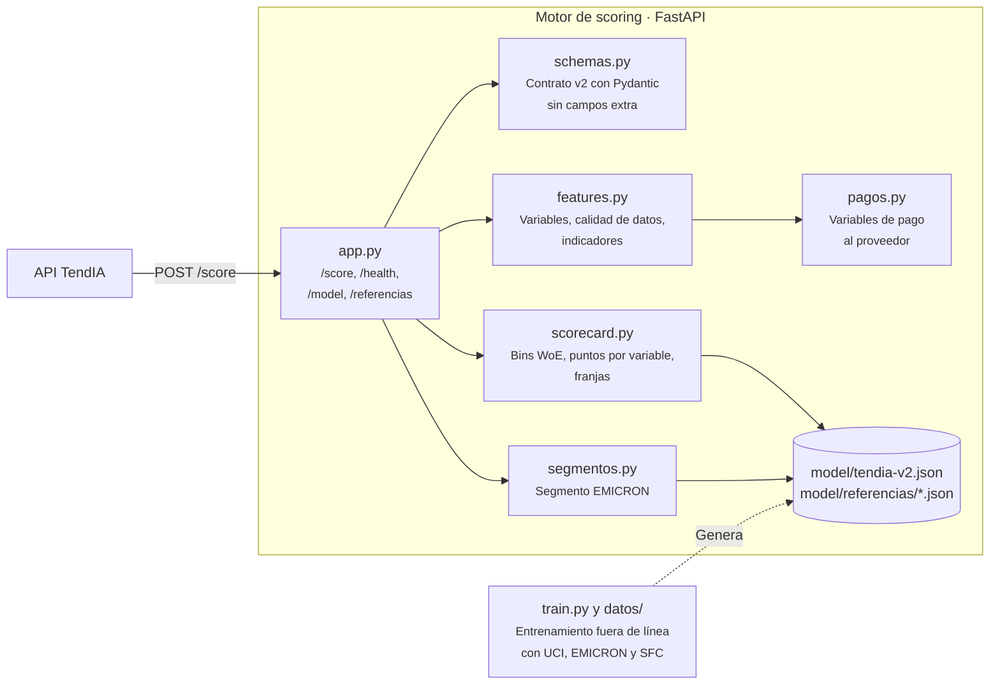

# Modelo C4

Tres niveles del [modelo C4](https://c4model.com/): contexto, contenedores y componentes. El nivel 4, el código, está en el [diagrama de clases](clases.md). Las decisiones detrás de esta división están en el [ADR-002](../adr/ADR-002-arquitectura.md).

Convención de colores: azul oscuro para personas, morado para lo que construimos, gris para sistemas externos.

## Nivel 1 · Contexto

Quién usa TendIA y con qué sistemas habla.

## Nivel 2 · Contenedores

Las piezas que se despliegan por separado. Las cuatro primeras corren en un solo proyecto de Vercel ([infraestructura](infraestructura.md)).

| Contenedor        | Responsabilidad                                                                                         | Estado que guarda                                                              |
| ----------------- | ------------------------------------------------------------------------------------------------------- | ------------------------------------------------------------------------------ |
| App del tendero   | Interfaz T1 a T13, Tendi y Mi cuaderno                                                                  | Solo el token de sesión en el dispositivo                                      |
| Portal del aliado | Interfaz A1 a A4, política, equipo, integraciones, auditoría y administración                           | Solo el token de sesión en el navegador                                        |
| API TendIA        | Única puerta a los datos: identidad, consentimientos, solicitudes, conectores, IA, avisos y API pública | Ninguno: todo está en Postgres ([monolito sin estado](monolito-sin-estado.md)) |
| Motor de scoring  | Variables, scorecard, segmento e indicadores                                                            | Ninguno: el modelo es un archivo de solo lectura en la imagen                  |
| Base de datos     | Datos del negocio, solicitudes, puntajes, adjuntos y bitácora                                           | Todo el estado del sistema                                                     |

## Nivel 3 · Componentes de la API

La API es un monolito modular: cada módulo de NestJS es un componente con su controlador, sus servicios y sus fronteras.

| Componente                     | Archivos                                                      | Expone                                                                                                                  |
| ------------------------------ | ------------------------------------------------------------- | ----------------------------------------------------------------------------------------------------------------------- |
| Auth                           | `src/auth`                                                    | `/auth/tendero/otp`, `/auth/tendero/verificar`, `/auth/aliado/login`, `/auth/aliado/mfa`, `/auth/invitacion/:token`     |
| Tendero                        | `src/tendero/tendero.*`                                       | `/me`, `/me/negocio`, `/fuentes`, `/consentimientos`, `/aliados`                                                        |
| Solicitudes y Evaluación       | `src/tendero/solicitudes.service.ts`, `evaluacion.service.ts` | `/solicitudes` y sus acciones (`evaluar`, `variaciones`, `enviar`, `garantia`, `visto`, `satisfaccion`)                 |
| Aliado                         | `src/aliado`                                                  | `/aliado/solicitudes`, `/aliado/politica`, `/aliado/api-keys`, `/aliado/equipo`, `/aliado/consumo`, `/aliado/auditoria` |
| Admin TendIA                   | `src/admin`                                                   | `/admin/aliados`, `/admin/bitacora`, `/admin/satisfaccion`                                                              |
| API pública                    | `src/public-api`                                              | `POST /v1/score`                                                                                                        |
| Asistente y Registros          | `src/asistente`, `src/registros`                              | `/asistente/mensajes`, `/me/registros`, `/me/cuaderno`, `/whatsapp/webhook`                                             |
| Conectores                     | `src/conectores`                                              | Interfaz `Conector` (sin rutas)                                                                                         |
| Explicación e IA               | `src/explicacion`, `src/ia`                                   | Interno                                                                                                                 |
| Notificador, Auditoría, Prisma | `src/notificaciones`, `src/common`, `src/prisma.service.ts`   | Interno                                                                                                                 |

## Nivel 3 · Componentes del scoring

