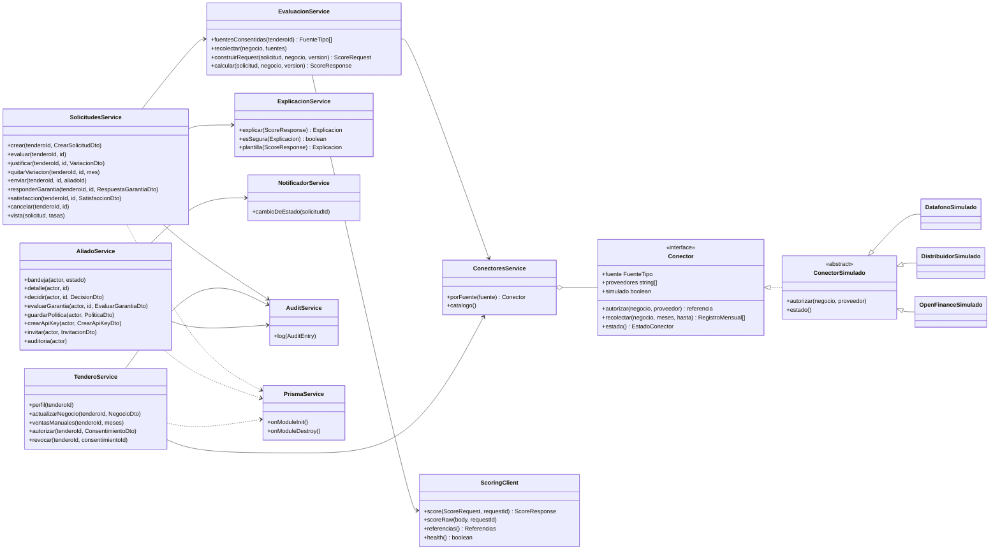
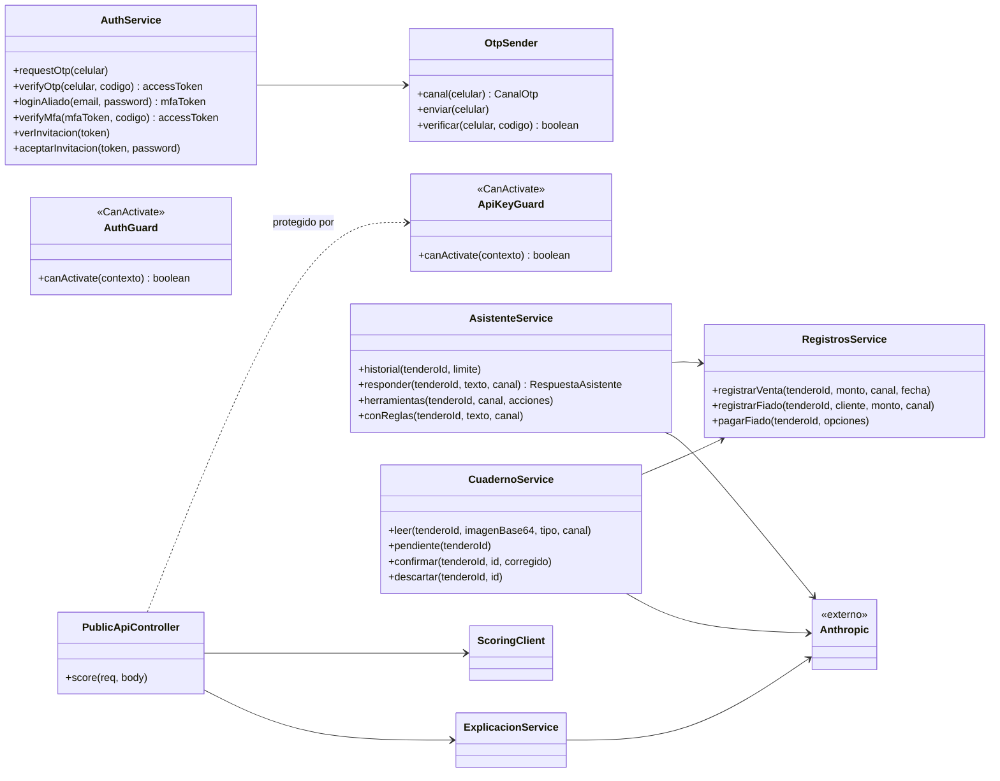
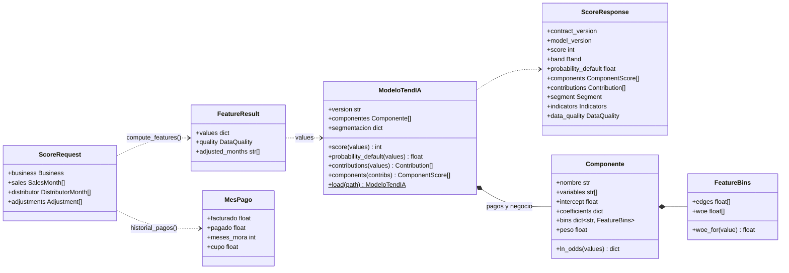

# Diagrama de clases

Nivel 4 del [modelo C4](c4.md): las clases principales con los nombres que tienen en el código. Las entidades persistentes (Tendero, Solicitud, Score…) son modelos de Prisma y están en el [diagrama entidad-relación](er.md).

## API: dominio de la solicitud

Un conector real (Bold, Treinta, Belvo) implementa `Conector` y se registra en `ConectoresService`; nada más cambia.

## API: identidad, asistente y API pública

`AuthGuard` es global: toda ruta exige un JWT con el rol correcto salvo las marcadas `@Public()`. La API pública usa `ApiKeyGuard` con la llave en `x-api-key`.

## Scoring

Cada `Componente` es un scorecard WoE con regresión logística. El puntaje es la suma de los puntos de cada variable, así que las contribuciones explican el resultado exacto.
