# Diagrama entidad-relación

Las 21 tablas de la base con todos sus campos. Se genera del esquema de Prisma, que es la fuente de verdad: [`services/api/prisma/schema.prisma`](../../services/api/prisma/schema.prisma). Los estados de una solicitud y las decisiones de protección de datos están en el [modelo de datos](../data-model.md).

`PK` es la llave primaria, `FK` una llave foránea y `UK` un valor único. Todos los `id` son UUID.

```mermaid
erDiagram
  Tendero ||--o| Negocio : "tiene"
  Tendero ||--o{ Consentimiento : "otorga"
  Tendero ||--o{ Solicitud : "crea"
  Tendero ||--o{ MensajeAsistente : "conversa con Tendi"
  Tendero ||--o{ ExtraccionCuaderno : "fotografía"
  Negocio ||--o{ DatoMensual : "acumula"
  Negocio ||--o{ VentaDiaria : "anota"
  Negocio ||--o{ Fiado : "fía"
  Aliado ||--o{ Usuario : "emplea"
  Aliado ||--o{ Invitacion : "invita"
  Aliado ||--o| Politica : "define"
  Aliado |o--o{ Solicitud : "revisa"
  Aliado ||--o{ ApiKey : "emite"
  Aliado ||--o{ ConsumoApi : "factura"
  ApiKey ||--o{ ConsumoApi : "registra"
  Solicitud ||--o{ Score : "versiones 1 y 2"
  Solicitud ||--o{ Variacion : "justifica"
  Solicitud ||--o| Garantia : "pide"
  Solicitud ||--o{ Adjunto : "evidencias"

  Tendero {
    string id PK
    string celularHash UK
    string celularCifrado
    string nombre
    string cedulaCifrada
    datetime creadoEn
  }
  OtpCodigo {
    string id PK
    string celularHash
    string codigoHash
    datetime expiraEn
    int intentos
    datetime usadoEn
    datetime creadoEn
  }
  Negocio {
    string id PK
    string tenderoId FK, UK
    string nombre
    string tipo
    string barrio
    string ciudad
    int antiguedadMeses
    int ventasMensualesDeclaradas
    string perfilSimulado
  }
  VentaDiaria {
    string id PK
    string negocioId FK
    string fecha
    int monto
    string canal
    datetime creadoEn
  }
  Fiado {
    string id PK
    string negocioId FK
    string cliente
    int monto
    string fecha
    datetime pagadoEn
    string canal
    datetime creadoEn
  }
  MensajeAsistente {
    string id PK
    string tenderoId FK
    string rol
    string contenido
    string canal
    json acciones
    datetime creadoEn
  }
  ExtraccionCuaderno {
    string id PK
    string tenderoId FK
    json datos
    string estado
    string canal
    datetime creadoEn
  }
  Consentimiento {
    string id PK
    string tenderoId FK
    FuenteTipo fuente
    string proveedor
    string versionTexto
    string finalidad
    string referencia
    datetime otorgadoEn
    datetime revocadoEn
  }
  DatoMensual {
    string id PK
    string negocioId FK
    FuenteTipo fuente
    string mes
    int ventas
    int transacciones
    int compras
    int facturas
    int pagadasATiempo
    float diasRetrasoPromedio
    int pagado
    int cupo
    datetime creadoEn
  }
  Aliado {
    string id PK
    string nombre
    string slug UK
    TipoAliado tipo
  }
  Usuario {
    string id PK
    string aliadoId FK
    string email UK
    string nombre
    string passwordHash
    RolUsuario rol
    string totpSecreto
    bool mfaActivo
    int intentosFallidos
    datetime bloqueadoHasta
    datetime creadoEn
  }
  Invitacion {
    string id PK
    string aliadoId FK
    string email
    string nombre
    RolUsuario rol
    string tokenHash UK
    datetime expiraEn
    datetime usadaEn
    string creadaPor
    datetime creadaEn
  }
  Politica {
    string id PK
    string aliadoId FK, UK
    int scoreMinAprobar
    int scoreMinConGarantia
    int montoMaximo
    int version
    datetime actualizadaEn
  }
  Solicitud {
    string id PK
    string tenderoId FK
    string aliadoId FK
    int monto
    string destino
    int plazoMeses
    EstadoSolicitud estado
    json calidadDatos
    string notaDecision
    int montoAprobado
    int plazoAprobado
    float tasaAprobada
    datetime decididaEn
    string decididaPor
    datetime enviadaEn
    int satisfaccion
    string comentarioSatisfaccion
    EstadoSolicitud estadoVisto
    datetime creadaEn
    datetime actualizadaEn
  }
  Score {
    string id PK
    string solicitudId FK
    int version
    int puntaje
    float probabilidadIncumplimiento
    string nivel
    string modeloVersion
    json segmento
    json componentes
    json contribuciones
    json indicadores
    json calidadDatos
    json explicacion
    string explicacionFuente
    bool conVariaciones
    datetime creadoEn
  }
  Variacion {
    string id PK
    string solicitudId FK
    string mes
    string motivo
    datetime creadaEn
  }
  Garantia {
    string id PK
    string solicitudId FK, UK
    TipoGarantia tipo
    string notaAliado
    string respuesta
    EstadoGarantia estado
    datetime creadaEn
    datetime actualizadaEn
  }
  Adjunto {
    string id PK
    string solicitudId FK
    string proposito
    string mes
    string nombre
    string tipo
    int tamano
    bytes datos
    datetime creadoEn
  }
  ApiKey {
    string id PK
    string aliadoId FK
    string nombre
    string prefijo UK
    string hash
    datetime creadaEn
    datetime revocadaEn
    datetime ultimoUso
  }
  ConsumoApi {
    string id PK
    string aliadoId FK
    string apiKeyId FK
    string endpoint
    int estado
    datetime creadoEn
  }
  Auditoria {
    string id PK
    string actorTipo
    string actorId
    string aliadoId
    string accion
    string entidad
    string entidadId
    string finalidad
    json detalle
    datetime creadoEn
  }
```

## Tablas sin relaciones

- **`OtpCodigo`**: códigos de ingreso por hash de celular, con vencimiento e intentos. No apunta a `Tendero` porque el código se pide antes de que el tendero exista.
- **`Auditoria`**: guarda IDs de actor, entidad y aliado como texto, no como llaves foráneas, para que borrar un registro no borre su rastro. Un trigger rechaza `UPDATE` y `DELETE`.

## Reglas que impone la base

| Regla                             | Cómo                                                            |
| --------------------------------- | --------------------------------------------------------------- |
| Un negocio por tendero            | `Negocio.tenderoId` único                                       |
| Un dato por negocio, fuente y mes | Único `(negocioId, fuente, mes)` en `DatoMensual`               |
| Una venta por día                 | Único `(negocioId, fecha)` en `VentaDiaria`                     |
| Una versión de puntaje por número | Único `(solicitudId, version)` en `Score`                       |
| Un mes justificado una sola vez   | Único `(solicitudId, mes)` en `Variacion`                       |
| Una garantía por solicitud        | `Garantia.solicitudId` único                                    |
| Borrar un tendero borra sus datos | `onDelete: Cascade` desde `Tendero` y `Negocio`                 |
| Cada aliado ve solo lo suyo       | Row Level Security con el rol `tendia_aliado` y `app.aliado_id` |
| Nadie edita la bitácora           | Trigger sobre `Auditoria`                                       |

## Enumeraciones

| Enum              | Valores                                                                                                                       |
| ----------------- | ----------------------------------------------------------------------------------------------------------------------------- |
| `FuenteTipo`      | `DATAFONO`, `DISTRIBUIDOR`, `OPEN_FINANCE`, `MANUAL`                                                                          |
| `EstadoSolicitud` | `BORRADOR`, `DATOS_INCOMPLETOS`, `SCORE_LISTO`, `ENVIADA`, `GARANTIA_SOLICITADA`, `GARANTIA_ENVIADA`, `APROBADA`, `RECHAZADA` |
| `RolUsuario`      | `ANALISTA`, `ADMIN_ALIADO`, `ADMIN_TENDIA`                                                                                    |
| `TipoAliado`      | `BANCO`, `FINTECH`, `MICROFINANCIERA`, `DISTRIBUIDOR`                                                                         |
| `TipoGarantia`    | `FNG`, `CODEUDOR`, `OTRA`                                                                                                     |
| `EstadoGarantia`  | `SOLICITADA`, `ENVIADA`, `ACEPTADA`, `RECHAZADA`                                                                              |
