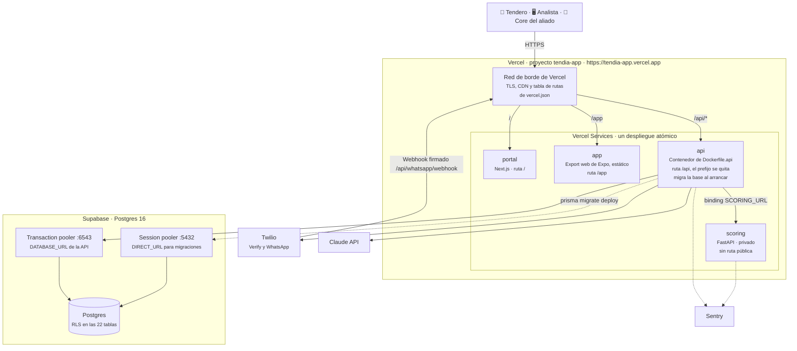
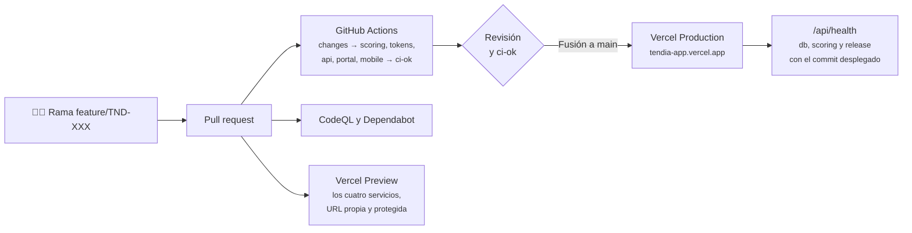
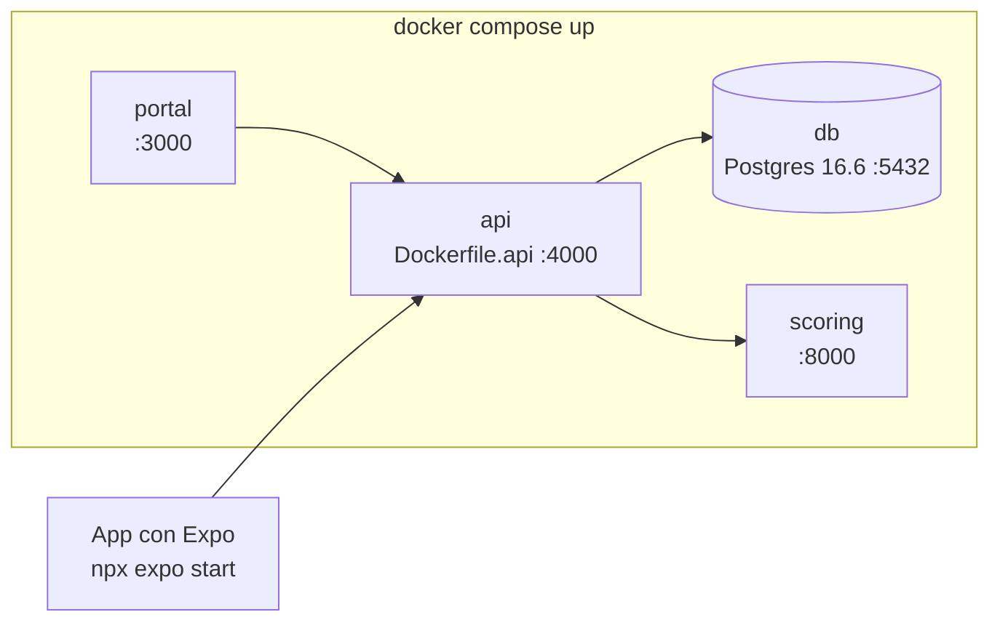

# Diagrama de infraestructura

Dónde corre cada pieza hoy, cómo llega el código hasta allá y cómo se corre en local. La evolución prevista está en el [plan de actualización de infraestructura](plan-infraestructura.md) y la operación en [deploy.md](../deploy.md).

## Staging y producción del MVP

Un solo proyecto de Vercel (`tendia-app`, plan Hobby) con Vercel Services y una base Postgres en Supabase.

| Pieza         | Dónde                      | Cómo se construye                                        | Variables principales                                                                                                         |
| ------------- | -------------------------- | -------------------------------------------------------- | ----------------------------------------------------------------------------------------------------------------------------- |
| portal        | Vercel, Next.js            | `pnpm install --filter @tendia/portal...` y `pnpm build` | `NEXT_PUBLIC_API_URL=/api`                                                                                                    |
| app           | Vercel, archivos estáticos | `npx expo export -p web` con `EXPO_BASE_URL=/app`        | `EXPO_PUBLIC_API_URL=/api`                                                                                                    |
| api           | Vercel, contenedor         | `Dockerfile.api` en la raíz, Node 22 y Prisma 6.1        | `DATABASE_URL`, `DIRECT_URL`, `JWT_SECRET`, `DATA_ENCRYPTION_KEY`, `ANTHROPIC_API_KEY`, `TWILIO_*`, `SENTRY_DSN`, `PORT=4000` |
| scoring       | Vercel, FastAPI            | `uv` con solo las dependencias de ejecución              | `SENTRY_DSN`                                                                                                                  |
| Base de datos | Supabase                   | Migraciones de Prisma                                    | —                                                                                                                             |

Los secretos viven como variables cifradas del proyecto de Vercel; nunca en archivos ni en el repositorio (`.vercelignore` excluye todo `.env`).

## Del código a producción

- CI corre solo las piezas que cambiaron y el check `ci-ok` es obligatorio para fusionar.
- Cada PR tiene su propio despliegue de vista previa con los cuatro servicios sincronizados.
- Cada fusión a `main` despliega sola. Volver atrás es promover el despliegue anterior en Vercel, porque los cuatro servicios se publican juntos.

## Desarrollo local

La API usa la misma imagen en local y en Vercel. Sin llaves de Claude o Twilio, la app funciona con plantillas y códigos de demostración.
