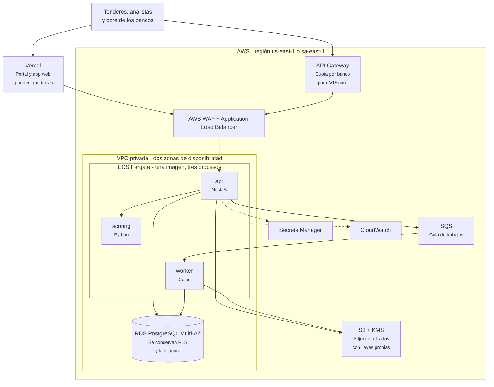

# Plan de actualización de infraestructura

La infraestructura cambia por **eventos medibles**, no por fechas. Cada fase tiene un disparador, lo que se hace, lo que cuesta y cómo se sabe que funcionó. Los meses y los presupuestos salen del modelo financiero a 36 meses ([planificación](../planificacion.md#modelo-financiero)). El código es el mismo en todas las fases: cambia dónde corre, no lo que es.

```mermaid
flowchart LR
  f0["<b>Fase 0 · hoy</b><br/><small>MVP en Vercel Hobby<br/>y Supabase Free</small>"]
  f1["<b>Fase 1 · meses 1-6</b><br/><small>Piloto pagado<br/>Planes Pro, dos ambientes,<br/>respaldos y prueba de carga</small>"]
  f2["<b>Fase 2 · meses 7-18</b><br/><small>Datos reales<br/>Cola de trabajos, worker<br/>con reintentos y caché</small>"]
  f3["<b>Fase 3 · meses 19-36</b><br/><small>Banco vigilado<br/>AWS: red privada,<br/>Multi-AZ y llaves propias</small>"]
  f4["<b>Fase 4 · mes 36+</b><br/><small>Separar un servicio<br/>solo si un criterio<br/>se cumple</small>"]
  f0 -- "Primer cliente paga" --> f1
  f1 -- "Convenio con Bold<br/>o Treinta" --> f2
  f2 -- "Primer banco vigilado<br/>por la SFC" --> f3
  f3 -- "Un módulo crece 10×<br/>o tiene su propio equipo" --> f4
```

## Carga esperada

| Momento | Clientes | Puntajes al mes | Pico estimado    | Presupuesto de infraestructura |
| ------- | -------- | --------------- | ---------------- | ------------------------------ |
| Mes 1   | 10       | 7.000           | 0,07 por segundo | $2,5M al mes (~USD 625)        |
| Mes 12  | 16       | 11.400          | 0,12 por segundo | $2,5M al mes                   |
| Mes 24  | 28       | 19.300          | 0,20 por segundo | $3,25M al mes                  |
| Mes 36  | 47       | 32.700          | 0,34 por segundo | $4,23M al mes (~USD 1.050)     |

El pico supone que todo pasa en 22 días hábiles de 12 horas y multiplica por 10. Aun así, en el mes 36 es **menos de un puntaje por segundo**. Con una TRM de $4.000.

## Fase 0 · Hoy: MVP

- Vercel Hobby con cuatro servicios (portal, app web, API en contenedor y scoring privado) y Supabase Free ([diagrama](infraestructura.md)).
- Costo: $0. Sirve para la demo y la validación, no para clientes: **el plan Hobby no admite uso comercial**.

## Fase 1 · Piloto pagado (meses 1 a 6)

**Disparador:** el primer cliente firma y paga.

| Qué                                                                       | Por qué                                                         |
| ------------------------------------------------------------------------- | --------------------------------------------------------------- |
| Pasar a Vercel Pro y Supabase Pro                                         | Uso comercial, más cómputo, respaldos diarios y soporte         |
| Dos ambientes separados: staging y producción, cada uno con su base       | Probar sin tocar datos de clientes                              |
| Respaldos probados: restaurar una copia cada mes                          | Un respaldo que nunca se restauró no es un respaldo             |
| Prueba de carga con k6 sobre `/solicitudes/:id/evaluar` y `/v1/score`     | Medir la capacidad en vez de suponerla                          |
| Límites de uso en Redis (Upstash) si la API corre en más de una instancia | Hoy los contadores del throttler viven en memoria por instancia |
| Alertas de Sentry y de `/api/health`                                      | Saber antes que el cliente                                      |
| Dominio propio y llaves de producción de Twilio y Claude                  | Salir del sandbox de WhatsApp y de la cuenta de prueba          |

**Costo:** precios de lista de Vercel Pro (USD 20 por miembro al mes) y Supabase Pro (desde USD 25 al mes), más uso. Cabe en los $2,5M al mes del modelo. Verificar precios al contratar.

**Listo cuando:** la prueba de carga sostiene 10 veces el pico del mes 12 con p95 menor a 3 s sin la IA, y una restauración de respaldo funcionó.

## Fase 2 · Datos reales (meses 7 a 18)

**Disparador:** firmamos con un proveedor real de datos (Bold, Treinta, un distribuidor o Belvo).

| Qué                                                                                 | Por qué                                                                                                             |
| ----------------------------------------------------------------------------------- | ------------------------------------------------------------------------------------------------------------------- |
| Conector real que implementa la interfaz `Conector`                                 | El resto del sistema no cambia                                                                                      |
| Cola de trabajos (Vercel Queues o SQS) y un **worker** que recolecta con reintentos | Las APIs de terceros son lentas o se caen; el tendero no debe esperar con la pantalla abierta                       |
| El worker es el mismo código de la API con otro punto de entrada                    | No hay un servicio nuevo que mantener                                                                               |
| Caché del perfil del tendero por 30 días                                            | El modelo financiero muestra que el 89 % del costo por puntaje son datos externos: no pagar dos veces el mismo dato |
| Ir al buró solo cuando el modelo tenga baja confianza                               | Es la consulta más cara ($1.800)                                                                                    |
| Webhooks del proveedor firmados e idempotentes                                      | Evitar datos duplicados                                                                                             |

**Listo cuando:** una caída simulada del proveedor no rompe ninguna solicitud y los reintentos la completan.

## Fase 3 · Migrar a AWS (meses 19 a 36)

**Disparador:** llega el primer banco vigilado por la Superintendencia Financiera, que exige red privada, cifrado con llaves propias, alta disponibilidad y auditoría de la nube.

| Qué                                                 | Por qué                                                                                              |
| --------------------------------------------------- | ---------------------------------------------------------------------------------------------------- |
| ECS Fargate con la misma imagen de `Dockerfile.api` | Sin servidores que administrar ni código que reescribir                                              |
| RDS PostgreSQL Multi-AZ                             | Si una zona se cae, la otra sigue; la seguridad depende de Postgres (RLS, trigger de la bitácora)    |
| Adjuntos de Postgres a S3 con KMS                   | Llaves propias y una base más liviana                                                                |
| WAF, balanceador y API Gateway con planes de uso    | Entrada protegida y una cuota por banco                                                              |
| Secrets Manager y CloudWatch                        | Secretos rotables y auditoría                                                                        |
| **Sin DynamoDB ni Cognito**                         | El aislamiento entre entidades y la bitácora dependen de PostgreSQL, y el ingreso ya está construido |

**Costo:** el equipo lo estima en USD 340 a 400 al mes (~$1,4M a $1,6M), dentro de los $4,23M al mes del año 3.

**Cómo se migra:** réplica lógica de Supabase a RDS, ventana corta para cambiar `DATABASE_URL`, y la API se despliega en ECS con la misma imagen. Se ensaya antes en staging.

**Listo cuando:** apagar una zona de disponibilidad no tumba el servicio y el banco aprueba la revisión de seguridad.

## Fase 4 · Separar servicios (mes 36 en adelante)

**Disparador:** un módulo cumple al menos un criterio medible:

- Su carga crece 10 veces más que la del resto.
- Necesita escalar de otra forma (por ejemplo, GPU o mucha memoria).
- Tiene un equipo propio que necesita desplegar a su ritmo.

**Candidatos:** la API pública (los bancos la llaman en lotes) y Tendi (conversaciones largas con la IA). Como cada módulo ya tiene fronteras, separarlo es mover una carpeta a otro proceso con la misma base o con una base propia, no reescribirlo.

## Lo que no cambia en ninguna fase

- El contrato de `/score` versionado y sus pruebas.
- Postgres con Row Level Security y la bitácora inmutable.
- Una sola imagen Docker para la API, igual en local y en la nube.
- CI obligatorio y despliegue automático desde `main`.

Por qué la base es un monolito sin estado: [monolito-sin-estado.md](monolito-sin-estado.md).
