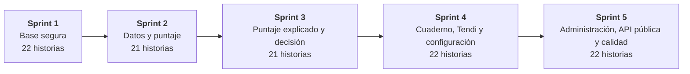

# Planificación

La planeación del MVP vive en **Jira**: 26 épicas, 108 historias de usuario y 314 subtareas repartidas en cinco sprints. Se importó desde el archivo [`docs/jira/tendia-jira.csv`](jira/tendia-jira.csv), que es la fuente de esta página. Cada épica lleva una etiqueta de área (app del tendero, cuaderno y Tendi, portal del aliado, equipo TendIA, scoring y API, seguridad, operación y próximas funcionalidades).

En GitHub también están los issues `TND-XXX` y sus milestones, con los que se organizó el trabajo técnico en el repositorio; los requerimientos los citan como trazabilidad.

## Resumen

| Elemento             | Cantidad |
| -------------------- | -------- |
| Épicas               | 26       |
| Historias de usuario | 108      |
| Subtareas            | 314      |
| Sprints              | 5        |

## Sprints

| Sprint   | Objetivo                                  | Alcance                                                                                                                                                                             | Historias | Subtareas |
| -------- | ----------------------------------------- | ----------------------------------------------------------------------------------------------------------------------------------------------------------------------------------- | --------- | --------- |
| Sprint 1 | **Base segura**                           | Ingreso del tendero con código, acceso al portal con MFA, protección de datos personales y despliegue en Vercel y Docker.                                                           | 22        | 68        |
| Sprint 2 | **Datos y puntaje**                       | Inicio y solicitud (T1), autorización de fuentes (T2), evaluación automática y datos faltantes (T4 a T6), revocar autorizaciones, conectores y motor de scoring.                    | 21        | 65        |
| Sprint 3 | **Puntaje explicado y decisión**          | Puntaje explicado y justificación de meses (T7, T8), compartir y seguimiento (T9 a T13), bandeja y detalle (A1, A2), decisión y garantías (A2 a A4) y explicación con IA.           | 21        | 60        |
| Sprint 4 | **Cuaderno, Tendi y configuración**       | Cuaderno digital, Tendi en la app y por WhatsApp, política de riesgo, llaves y consumo de API, equipo, satisfacción y auditoría del aliado.                                         | 22        | 68        |
| Sprint 5 | **Administración, API pública y calidad** | Accesibilidad, atención al titular y gestión de entidades por el equipo TendIA, API pública, CI y pruebas de extremo a extremo, y el backlog de próximas funcionalidades (Anexo D). | 22        | 53        |

## Épicas

| ID  | Épica                                                      | Área                     | Historias | Sprint |
| --- | ---------------------------------------------------------- | ------------------------ | --------- | ------ |
| 1   | Ingreso del tendero con celular y código                   | App del tendero          | 5         | 1      |
| 27  | Inicio y creación de la solicitud de crédito               | App del tendero          | 4         | 2      |
| 47  | Autorización de fuentes de datos (T2)                      | App del tendero          | 2         | 2      |
| 57  | Evaluación automática y datos faltantes (T4, T5, T6)       | App del tendero          | 4         | 2      |
| 77  | Puntaje TendIA explicado y justificación de meses (T7, T8) | App del tendero          | 4         | 3      |
| 96  | Compartir con una entidad y seguimiento (T9 a T13)         | App del tendero          | 5         | 3      |
| 116 | Mis autorizaciones                                         | App del tendero          | 1         | 2      |
| 122 | Diseño accesible de la app                                 | App del tendero          | 2         | 5      |
| 130 | Cuaderno digital                                           | Cuaderno y Tendi         | 5         | 4      |
| 153 | Tendi, el asistente con IA                                 | Cuaderno y Tendi         | 6         | 4      |
| 179 | Tendi por WhatsApp                                         | Cuaderno y Tendi         | 4         | 4      |
| 195 | Acceso seguro al portal                                    | Portal del aliado        | 5         | 1      |
| 218 | Bandeja y detalle de solicitudes (A1, A2)                  | Portal del aliado        | 6         | 3      |
| 241 | Decisión y garantías (A2, A3, A4)                          | Portal del aliado        | 4         | 3      |
| 257 | Configuración de la entidad                                | Portal del aliado        | 5         | 4      |
| 278 | Satisfacción y auditoría del aliado                        | Portal del aliado        | 2         | 4      |
| 287 | Atención al titular de los datos                           | Equipo TendIA            | 2         | 5      |
| 296 | Gestión de entidades aliadas                               | Equipo TendIA            | 3         | 5      |
| 309 | API pública para el core del aliado                        | Scoring y API            | 3         | 5      |
| 321 | Conectores de datos                                        | Scoring y API            | 4         | 2      |
| 335 | Motor de scoring tendia-v2                                 | Scoring y API            | 6         | 2      |
| 357 | Explicación del puntaje con IA                             | Scoring y API            | 2         | 3      |
| 365 | Protección de datos personales                             | Seguridad                | 8         | 1      |
| 395 | Despliegue y operación                                     | Operación y calidad      | 4         | 1      |
| 410 | Calidad y pruebas                                          | Operación y calidad      | 2         | 5      |
| 418 | Próximas funcionalidades (Anexo D)                         | Próximas funcionalidades | 10        | 5      |

## Historias por sprint

Cada historia se escribió como _Como… quiero… para…_, con criterios de aceptación en Gherkin (Given / When / Then) y subtareas técnicas. El texto completo está en el [CSV de Jira](jira/tendia-jira.csv).

### Sprint 1 · Base segura

| ID  | Historia                                                                                                                                                                                        | Épica                                    | Subtareas |
| --- | ----------------------------------------------------------------------------------------------------------------------------------------------------------------------------------------------- | ---------------------------------------- | --------- |
| 2   | **Solicitar el código de ingreso con mi celular.** Como tendero, quiero ingresar solo con mi número de celular, para no tener que recordar contraseñas.                                         | Ingreso del tendero con celular y código | 4         |
| 7   | **Verificar el código y crear la cuenta en el primer ingreso.** Como tendero, quiero confirmar mi identidad con el código que recibí, para entrar a la app o registrarme la primera vez.        | Ingreso del tendero con celular y código | 5         |
| 13  | **Limitar intentos y envíos de códigos.** Como tendero, quiero que mi cuenta esté protegida contra intentos de adivinar el código, para que nadie entre con mi número.                          | Ingreso del tendero con celular y código | 4         |
| 18  | **Ingresar con celulares de demostración fuera de producción.** Como equipo de TendIA, quiero usar celulares de demostración con perfiles simulados, para hacer demos y pruebas sin enviar SMS. | Ingreso del tendero con celular y código | 3         |
| 22  | **Cerrar sesión y manejar la sesión vencida.** Como tendero, quiero cerrar mi sesión y que la app reaccione si mi sesión vence, para proteger mi cuenta en un celular compartido.               | Ingreso del tendero con celular y código | 4         |
| 196 | **Ingresar al portal con correo y contraseña.** Como analista, quiero ingresar con mi correo y contraseña, para acceder al portal de mi entidad.                                                | Acceso seguro al portal                  | 4         |
| 201 | **Activar y usar la verificación en dos pasos (MFA).** Como analista, quiero proteger mi cuenta con una app autenticadora, para que nadie entre solo con mi contraseña.                         | Acceso seguro al portal                  | 4         |
| 206 | **Bloquear la cuenta tras intentos fallidos.** Como administrador del aliado, quiero que las cuentas se bloqueen ante intentos repetidos, para evitar accesos por fuerza bruta.                 | Acceso seguro al portal                  | 3         |
| 210 | **Aceptar una invitación y crear mi cuenta.** Como persona invitada por una entidad, quiero crear mi cuenta desde el enlace que recibí, para empezar a usar el portal.                          | Acceso seguro al portal                  | 3         |
| 214 | **Navegar el portal según mi rol.** Como usuario del portal, quiero ver solo las opciones de mi rol, para no confundirme ni acceder a lo que no me corresponde.                                 | Acceso seguro al portal                  | 3         |
| 366 | **Cifrar los datos personales.** Como responsable de cumplimiento, quiero que los datos personales estén cifrados, para cumplir la Ley 1581.                                                    | Protección de datos personales           | 3         |
| 370 | **Aislar los datos por entidad con Row Level Security.** Como administrador del aliado, quiero que ninguna otra entidad vea mis solicitudes, para proteger la confidencialidad.                 | Protección de datos personales           | 3         |
| 374 | **Mantener una bitácora inmutable.** Como responsable de cumplimiento, quiero una bitácora que no se pueda alterar, para demostrar quién hizo qué ante la SIC.                                  | Protección de datos personales           | 3         |
| 378 | **Controlar los archivos adjuntos.** Como responsable de seguridad, quiero que los adjuntos sean seguros y de acceso controlado, para evitar archivos maliciosos y fugas.                       | Protección de datos personales           | 3         |
| 382 | **Limitar la tasa de peticiones.** Como responsable de seguridad, quiero límites de peticiones por ruta, para evitar abusos y ataques.                                                          | Protección de datos personales           | 2         |
| 385 | **Registrar logs y errores sin datos personales.** Como responsable de seguridad, quiero que los logs no expongan datos sensibles, para cumplir la Ley 1581.                                    | Protección de datos personales           | 3         |
| 389 | **Aplicar cabeceras de seguridad en el portal.** Como responsable de seguridad, quiero que el portal no se pueda incrustar ni revele su tecnología, para reducir la superficie de ataque.       | Protección de datos personales           | 2         |
| 392 | **Publicar documentos legales y revisión OWASP.** Como responsable de cumplimiento, quiero tener la política de datos, el aviso de privacidad y la revisión OWASP, para cumplir la regulación.  | Protección de datos personales           | 2         |
| 396 | **Exponer el estado de salud del sistema.** Como equipo de TendIA, quiero un endpoint de salud, para monitorear la plataforma.                                                                  | Despliegue y operación                   | 2         |
| 399 | **Funcionar sin servicios externos.** Como equipo de TendIA, quiero que el sistema funcione aunque falte Claude, Twilio o Sentry, para no depender de terceros.                                 | Despliegue y operación                   | 2         |
| 402 | **Cargar datos de demostración.** Como equipo de TendIA, quiero cuentas y políticas de demostración, para hacer demos rápido.                                                                   | Despliegue y operación                   | 3         |
| 406 | **Desplegar en Vercel y ejecutar en local con Docker.** Como equipo de TendIA, quiero un despliegue automático y un entorno local reproducible, para entregar rápido y con confianza.           | Despliegue y operación                   | 3         |

### Sprint 2 · Datos y puntaje

| ID  | Historia                                                                                                                                                                                   | Épica                                                | Subtareas |
| --- | ------------------------------------------------------------------------------------------------------------------------------------------------------------------------------------------ | ---------------------------------------------------- | --------- |
| 28  | **Ver la pantalla de inicio con el estado de mi solicitud.** Como tendero, quiero ver en el inicio cómo va mi solicitud, para saber qué sigue sin buscar.                                  | Inicio y creación de la solicitud de crédito         | 5         |
| 34  | **Ver el aviso de una nueva respuesta de la entidad.** Como tendero, quiero enterarme en el inicio de que la entidad respondió, para actuar a tiempo.                                      | Inicio y creación de la solicitud de crédito         | 3         |
| 38  | **Crear una solicitud de crédito (T1).** Como tendero, quiero decir cuánto necesito, para qué y en cuánto tiempo, para iniciar mi solicitud de crédito.                                    | Inicio y creación de la solicitud de crédito         | 4         |
| 43  | **Permitir solo una solicitud abierta por tendero.** Como tendero, quiero tener una sola solicitud abierta a la vez, para no confundirme con varias solicitudes en paralelo.               | Inicio y creación de la solicitud de crédito         | 3         |
| 48  | **Autorizar las fuentes de datos de mi negocio.** Como tendero, quiero dar permiso fuente por fuente para leer los datos de mi negocio, para que calculen mi puntaje con información real. | Autorización de fuentes de datos (T2)                | 4         |
| 53  | **Elegir el proveedor de una fuente.** Como tendero, quiero indicar qué proveedor uso para una fuente, para que traigan los datos del lugar correcto.                                      | Autorización de fuentes de datos (T2)                | 3         |
| 58  | **Evaluar automáticamente mi negocio.** Como tendero, quiero que TendIA traiga mis datos y calcule mi puntaje mostrándome el avance, para saber que algo está pasando.                     | Evaluación automática y datos faltantes (T4, T5, T6) | 5         |
| 64  | **Detectar datos incompletos para el puntaje.** Como tendero, quiero saber exactamente qué información falta, para poder completarla y obtener mi puntaje.                                 | Evaluación automática y datos faltantes (T4, T5, T6) | 3         |
| 68  | **Completar los datos del negocio y estimar mis ventas.** Como tendero, quiero completar lo que falta de forma sencilla, para poder calcular mi puntaje.                                   | Evaluación automática y datos faltantes (T4, T5, T6) | 4         |
| 73  | **Escribir las ventas de los últimos 6 meses.** Como tendero, quiero copiar mis ventas del cuaderno de papel, para tener historial suficiente.                                             | Evaluación automática y datos faltantes (T4, T5, T6) | 3         |
| 117 | **Revocar una autorización de datos.** Como tendero, quiero ver qué datos autoricé y quitar el permiso cuando quiera, para ejercer mi derecho de supresión.                                | Mis autorizaciones                                   | 4         |
| 322 | **Traer las ventas del datáfono.** Como tendero, quiero que TendIA lea mis ventas del datáfono, para usarlas en mi puntaje.                                                                | Conectores de datos                                  | 2         |
| 325 | **Traer los pagos al distribuidor.** Como tendero, quiero que TendIA lea cómo le pago a mi proveedor, para demostrar que pago a tiempo.                                                    | Conectores de datos                                  | 2         |
| 328 | **Traer los ingresos de la cuenta bancaria (open finance).** Como tendero, quiero que TendIA lea lo que entra a mi cuenta, para complementar mis ventas.                                   | Conectores de datos                                  | 2         |
| 331 | **Simular datos reproducibles con perfiles de demostración.** Como equipo de TendIA, quiero que la simulación sea reproducible y realista, para hacer demos y pruebas confiables.          | Conectores de datos                                  | 3         |
| 336 | **Calcular el puntaje con el scorecard interpretable.** Como analista, quiero un puntaje explicable variable por variable, para cumplir el SARC y entender el riesgo.                      | Motor de scoring tendia-v2                           | 4         |
| 341 | **Preparar las ventas con prioridad de fuentes y meses justificados.** Como equipo de TendIA, quiero que las ventas se preparen con reglas claras, para que el puntaje sea consistente.    | Motor de scoring tendia-v2                           | 2         |
| 344 | **Evaluar la calidad de los datos y generar alertas.** Como analista, quiero ver alertas de inconsistencias, para detectar posibles errores o fraudes.                                     | Motor de scoring tendia-v2                           | 2         |
| 347 | **Calcular los indicadores del negocio.** Como analista, quiero ver indicadores de contexto, para complementar el puntaje.                                                                 | Motor de scoring tendia-v2                           | 2         |
| 350 | **Asignar el segmento con datos del DANE.** Como analista, quiero saber a qué segmento real pertenece el negocio, para contextualizar el riesgo.                                           | Motor de scoring tendia-v2                           | 2         |
| 353 | **Calcular las tasas de referencia de la Superfinanciera.** Como analista, quiero tener una tasa de referencia por franja, para precargar condiciones razonables.                          | Motor de scoring tendia-v2                           | 3         |

### Sprint 3 · Puntaje explicado y decisión

| ID  | Historia                                                                                                                                                                                      | Épica                                                      | Subtareas |
| --- | --------------------------------------------------------------------------------------------------------------------------------------------------------------------------------------------- | ---------------------------------------------------------- | --------- |
| 78  | **Ver mi Puntaje TendIA explicado.** Como tendero, quiero ver mi puntaje y por qué lo obtuve en palabras sencillas, para entender mi situación antes de compartirlo.                          | Puntaje TendIA explicado y justificación de meses (T7, T8) | 4         |
| 83  | **Ver mi segmento y las tasas de referencia del mercado.** Como tendero, quiero saber a qué negocios me parezco y cuánto cobran las entidades, para comparar ofertas y evitar el gota a gota. | Puntaje TendIA explicado y justificación de meses (T7, T8) | 3         |
| 87  | **Justificar un mes de ventas bajas.** Como tendero, quiero explicar por qué un mes vendí poco, para que ese mes no cuente en mi contra.                                                      | Puntaje TendIA explicado y justificación de meses (T7, T8) | 4         |
| 92  | **Adjuntar evidencia a una justificación.** Como tendero, quiero adjuntar una foto o PDF que respalde mi justificación, para que la entidad me crea.                                          | Puntaje TendIA explicado y justificación de meses (T7, T8) | 3         |
| 97  | **Compartir mi puntaje con una entidad.** Como tendero, quiero elegir a qué entidad le muestro mi puntaje, para controlar quién ve mis datos.                                                 | Compartir con una entidad y seguimiento (T9 a T13)         | 3         |
| 101 | **Seguir el estado de mi solicitud.** Como tendero, quiero saber en todo momento quién revisa mi solicitud, para estar tranquilo y saber qué hacer.                                           | Compartir con una entidad y seguimiento (T9 a T13)         | 2         |
| 104 | **Responder una solicitud de garantía (T10).** Como tendero, quiero entender qué garantía me piden y responder con un documento, para seguir con mi crédito.                                  | Compartir con una entidad y seguimiento (T9 a T13)         | 3         |
| 108 | **Ver el resultado de mi solicitud (T12, T13).** Como tendero, quiero conocer la decisión de la entidad con su detalle, para saber qué sigue.                                                 | Compartir con una entidad y seguimiento (T9 a T13)         | 3         |
| 112 | **Calificar mi experiencia con TendIA.** Como tendero, quiero calificar qué tan fácil fue pedir mi crédito, para ayudar a mejorar el servicio.                                                | Compartir con una entidad y seguimiento (T9 a T13)         | 3         |
| 219 | **Ver la bandeja de solicitudes.** Como analista, quiero ver de un vistazo las solicitudes que me compartieron, para priorizar mi trabajo.                                                    | Bandeja y detalle de solicitudes (A1, A2)                  | 3         |
| 223 | **Filtrar la bandeja por franja del puntaje.** Como analista, quiero filtrar por franja, para enfocarme en un tipo de riesgo.                                                                 | Bandeja y detalle de solicitudes (A1, A2)                  | 2         |
| 226 | **Ver la sugerencia según la política de riesgo.** Como analista, quiero ver una sugerencia de decisión basada en la política de mi entidad, para decidir más rápido y de forma consistente.  | Bandeja y detalle de solicitudes (A1, A2)                  | 2         |
| 229 | **Ver el puntaje explicado en el detalle de la solicitud.** Como analista, quiero ver el puntaje y cuánto pesó cada variable, para entender el riesgo antes de decidir.                       | Bandeja y detalle de solicitudes (A1, A2)                  | 4         |
| 234 | **Ver ventas, pagos y meses justificados en el detalle.** Como analista, quiero ver el historial de ventas, pagos al proveedor y justificaciones, para validar la información del tendero.    | Bandeja y detalle de solicitudes (A1, A2)                  | 3         |
| 238 | **Ver indicadores, segmento, referencia de mercado y alertas.** Como analista, quiero tener contexto adicional del negocio, para complementar mi análisis.                                    | Bandeja y detalle de solicitudes (A1, A2)                  | 2         |
| 242 | **Aprobar un crédito con condiciones.** Como analista, quiero aprobar una solicitud fijando monto, plazo y tasa, para formalizar la oferta al tendero.                                        | Decisión y garantías (A2, A3, A4)                          | 3         |
| 246 | **Pedir una garantía al tendero.** Como analista, quiero pedir una garantía cuando el riesgo lo amerite, para poder aprobar con respaldo.                                                     | Decisión y garantías (A2, A3, A4)                          | 3         |
| 250 | **Rechazar una solicitud.** Como analista, quiero rechazar una solicitud, para cerrar los casos que no cumplen la política.                                                                   | Decisión y garantías (A2, A3, A4)                          | 2         |
| 253 | **Evaluar la garantía del tendero.** Como analista, quiero revisar la respuesta y el documento de garantía, para cerrar la solicitud.                                                         | Decisión y garantías (A2, A3, A4)                          | 3         |
| 358 | **Generar la explicación del puntaje con Claude.** Como tendero, quiero una explicación sencilla de mi puntaje, para entender qué mejorar.                                                    | Explicación del puntaje con IA                             | 2         |
| 361 | **Validar la explicación y usar la plantilla de respaldo.** Como equipo de TendIA, quiero descartar explicaciones inseguras, para no confundir ni prometer créditos.                          | Explicación del puntaje con IA                             | 3         |

### Sprint 4 · Cuaderno, Tendi y configuración

| ID  | Historia                                                                                                                                                                            | Épica                               | Subtareas |
| --- | ----------------------------------------------------------------------------------------------------------------------------------------------------------------------------------- | ----------------------------------- | --------- |
| 131 | **Anotar la venta del día.** Como tendero, quiero anotar cuánto vendí hoy, para llevar mis cuentas y que cuenten para mi puntaje.                                                   | Cuaderno digital                    | 3         |
| 135 | **Registrar fiados y marcarlos como pagados.** Como tendero, quiero anotar lo que le fío a mis clientes y marcar cuando me pagan, para saber cuánto me deben.                       | Cuaderno digital                    | 3         |
| 139 | **Pasar el cuaderno de papel a la app con una foto.** Como tendero, quiero tomar una foto de mi cuaderno y que la app lea las ventas y fiados, para no escribir todo de nuevo.      | Cuaderno digital                    | 6         |
| 146 | **Validar fechas y montos del cuaderno.** Como equipo de TendIA, quiero que el cuaderno solo acepte datos razonables, para que el puntaje no se alimente de errores.                | Cuaderno digital                    | 2         |
| 149 | **Contar las ventas del cuaderno en el puntaje.** Como tendero, quiero que mis ventas anotadas cuenten para mi puntaje, para tener historial aunque no use datáfono.                | Cuaderno digital                    | 3         |
| 154 | **Conversar con Tendi en la app.** Como tendero, quiero hablar con un asistente como le hablaría a un vecino, para anotar y preguntar sin formularios.                              | Tendi, el asistente con IA          | 4         |
| 159 | **Anotar ventas y fiados en lenguaje natural.** Como tendero, quiero decirle a Tendi mis ventas y fiados con mis propias palabras, para anotar rápido.                              | Tendi, el asistente con IA          | 3         |
| 163 | **Consultar mi resumen y el estado de mi crédito con Tendi.** Como tendero, quiero preguntarle a Tendi cómo voy y cómo va mi crédito, para saberlo sin navegar la app.              | Tendi, el asistente con IA          | 3         |
| 167 | **Evitar que Tendi anote dos veces lo mismo.** Como tendero, quiero que Tendi recuerde lo que ya anotó, para no tener registros duplicados.                                         | Tendi, el asistente con IA          | 3         |
| 171 | **Responder con reglas cuando la IA no esté disponible.** Como tendero, quiero que Tendi funcione aunque falle la IA, para poder anotar siempre.                                    | Tendi, el asistente con IA          | 3         |
| 175 | **Aplicar las reglas de comportamiento de Tendi.** Como equipo de TendIA, quiero que Tendi siga reglas claras de seguridad y tono, para proteger al tendero y la marca.             | Tendi, el asistente con IA          | 3         |
| 180 | **Recibir mensajes verificados de WhatsApp.** Como tendero, quiero escribirle a Tendi por WhatsApp, para usarlo sin abrir la app.                                                   | Tendi por WhatsApp                  | 3         |
| 184 | **Responder a celulares no registrados por WhatsApp.** Como persona no registrada, quiero saber qué hacer si escribo sin cuenta, para poder registrarme.                            | Tendi por WhatsApp                  | 2         |
| 187 | **Guardar la foto del cuaderno enviada por WhatsApp.** Como tendero, quiero mandar la foto de mi cuaderno por WhatsApp, para pasarlo sin abrir la app.                              | Tendi por WhatsApp                  | 3         |
| 191 | **Avisar las decisiones de la entidad por WhatsApp (T11).** Como tendero, quiero recibir por WhatsApp la decisión de la entidad, para enterarme de inmediato.                       | Tendi por WhatsApp                  | 3         |
| 258 | **Configurar la política de riesgo.** Como administrador del aliado, quiero definir los puntajes mínimos y el monto máximo, para que las sugerencias reflejen mi apetito de riesgo. | Configuración de la entidad         | 3         |
| 262 | **Crear y revocar llaves de API.** Como administrador del aliado, quiero crear llaves para integrar mi core, para consultar el puntaje desde mi sistema.                            | Configuración de la entidad         | 3         |
| 266 | **Ver el consumo de la API.** Como analista, quiero ver cuántas consultas hace mi entidad, para controlar lo que se factura.                                                        | Configuración de la entidad         | 3         |
| 270 | **Invitar personas a mi equipo.** Como administrador del aliado, quiero invitar analistas y administradores, para que mi equipo use el portal.                                      | Configuración de la entidad         | 3         |
| 274 | **Ver mi equipo y anular invitaciones.** Como administrador del aliado, quiero ver quién tiene acceso y anular invitaciones, para controlar el acceso a mi entidad.                 | Configuración de la entidad         | 3         |
| 279 | **Ver la satisfacción de los tenderos.** Como analista, quiero ver qué tan fácil les pareció el proceso a los tenderos, para mejorar la experiencia.                                | Satisfacción y auditoría del aliado | 3         |
| 283 | **Consultar la auditoría de mi entidad.** Como administrador del aliado, quiero saber quién consultó o cambió qué, cuándo y para qué, para cumplir y controlar el uso de datos.     | Satisfacción y auditoría del aliado | 3         |

### Sprint 5 · Administración, API pública y calidad

| ID  | Historia                                                                                                                                                                                                 | Épica                               | Subtareas |
| --- | -------------------------------------------------------------------------------------------------------------------------------------------------------------------------------------------------------- | ----------------------------------- | --------- |
| 123 | **Aplicar tamaños, contraste y lenguaje simple.** Como tendero, quiero leer y tocar todo con facilidad, para usar la app sin ayuda.                                                                      | Diseño accesible de la app          | 3         |
| 127 | **Ser compatible con lectores de pantalla.** Como tendero con baja visión, quiero usar la app con un lector de pantalla, para no depender de otra persona.                                               | Diseño accesible de la app          | 2         |
| 288 | **Consultar la bitácora de un tendero.** Como miembro del Equipo TendIA, quiero ver quién vio los datos de un tendero, cuándo y para qué, para atender reclamos y requerimientos de la SIC.              | Atención al titular de los datos    | 3         |
| 292 | **Ver la satisfacción de todas las entidades.** Como miembro del Equipo TendIA, quiero ver la satisfacción de todos los aliados, para medir la experiencia global.                                       | Atención al titular de los datos    | 3         |
| 297 | **Dar de alta una entidad aliada.** Como miembro del Equipo TendIA, quiero dar de alta una entidad cuando firma con TendIA, para que pueda empezar a usar el portal.                                     | Gestión de entidades aliadas        | 3         |
| 301 | **Ver el estado de las entidades y reinvitar administradores.** Como miembro del Equipo TendIA, quiero ver el estado de cada entidad y reenviar invitaciones, para asegurar que todas estén operativas.  | Gestión de entidades aliadas        | 3         |
| 305 | **Reiniciar la verificación en dos pasos de un usuario.** Como miembro del equipo técnico de TendIA, quiero reiniciar el MFA de quien perdió su autenticador, para que recupere el acceso.               | Gestión de entidades aliadas        | 3         |
| 310 | **Consultar el puntaje desde el core de la entidad.** Como sistema core del aliado, quiero calcular el Puntaje TendIA enviando los datos del negocio, para integrar el puntaje en mi proceso de crédito. | API pública para el core del aliado | 3         |
| 314 | **Validar el contrato v2 de la API pública.** Como sistema core del aliado, quiero recibir errores claros si envío datos inválidos, para corregir mi integración.                                        | API pública para el core del aliado | 2         |
| 317 | **Registrar el consumo de la API para facturación.** Como equipo de TendIA, quiero registrar cada consulta de la API, para facturar a las entidades.                                                     | API pública para el core del aliado | 3         |
| 411 | **Ejecutar CI por piezas con check obligatorio.** Como equipo de TendIA, quiero que solo se pruebe lo que cambió y que el check ci-ok sea obligatorio, para fusionar rápido y seguro.                    | Calidad y pruebas                   | 2         |
| 414 | **Automatizar los flujos felices de extremo a extremo.** Como equipo de TendIA, quiero pruebas e2e del portal y la app, para detectar regresiones en los flujos críticos.                                | Calidad y pruebas                   | 3         |
| 419 | **Hablarle a Tendi por voz.** Como tendero, quiero dictarle a Tendi mis ventas y fiados, para anotar sin escribir.                                                                                       | Próximas funcionalidades (Anexo D)  | 2         |
| 422 | **Integrar conectores reales con los proveedores.** Como tendero, quiero que TendIA lea mis datos reales del datáfono, distribuidor y banco, para que mi puntaje refleje mi negocio real.                | Próximas funcionalidades (Anexo D)  | 2         |
| 425 | **Avisar la decisión por correo o SMS y por webhooks a las entidades.** Como tendero y entidad aliada, quiero recibir avisos por más canales, para no perder ninguna novedad.                            | Próximas funcionalidades (Anexo D)  | 2         |
| 428 | **Enviar las invitaciones automáticamente por correo.** Como administrador del aliado, quiero que TendIA envíe la invitación por correo, para no tener que copiar enlaces.                               | Próximas funcionalidades (Anexo D)  | 2         |
| 431 | **Gestionar las personas del equipo desde el portal.** Como administrador del aliado, quiero quitar personas, cambiar su rol y reiniciar su MFA, para administrar mi equipo sin pedir soporte.           | Próximas funcionalidades (Anexo D)  | 2         |
| 434 | **Ver el historial de versiones de la política de riesgo.** Como administrador del aliado, quiero ver las versiones anteriores de la política, para auditar los cambios.                                 | Próximas funcionalidades (Anexo D)  | 2         |
| 437 | **Pedir más información al tendero.** Como analista, quiero pedirle al tendero información adicional sin exigir garantía, para decidir con más contexto.                                                 | Próximas funcionalidades (Anexo D)  | 2         |
| 440 | **Buscar, ordenar y paginar la bandeja.** Como analista, quiero buscar, ordenar por columnas y paginar la bandeja, para manejar muchas solicitudes.                                                      | Próximas funcionalidades (Anexo D)  | 2         |
| 443 | **Quitar una justificación desde la app.** Como tendero, quiero quitar una justificación que hice por error, para corregir mi información.                                                               | Próximas funcionalidades (Anexo D)  | 2         |
| 446 | **Pedir la cédula del tendero.** Como entidad aliada, quiero conocer la cédula del tendero, para validar su identidad.                                                                                   | Próximas funcionalidades (Anexo D)  | 2         |

## Entregas

| Fecha       | Entrega                                                                   |
| ----------- | ------------------------------------------------------------------------- |
| 23 oct 2026 | v0.1: flujo completo del tendero, puntaje explicado y aliado (#59)        |
| 25 oct 2026 | MVP con datos reales, IA, RLS, Twilio Verify e historias pendientes (#83) |
| 28 oct 2026 | Alta de aliados, prueba completa por rol y recorridos en GIF (#93)        |
| 4 nov 2026  | Despliegue en Vercel y release v1.0.0 (#103)                              |
| 10 nov 2026 | App del tendero en web, en `/app` (#106)                                  |

## Equipo y responsabilidades

| Persona           | Rol                         | Responde por                               |
| ----------------- | --------------------------- | ------------------------------------------ |
| Andersson Sánchez | QA & Data/ML Lead           | Calidad, CI, datos y modelo, despliegue    |
| Cristian Pedraza  | Backend Developer           | API, seguridad, arquitectura               |
| David Villadiego  | Data Scientist              | Variables, scorecard y model card          |
| David Sarria      | Product & Business Strategy | Producto, modelo de negocio y pitch        |
| Juan Lozano       | UX/UI & Wireframes          | Wireframes, mockups y prueba de usabilidad |
| Raquel Selma      | Documentation & QA          | Documentación, legal y pruebas             |

## Cómo trabajamos

- Scrum en Jira: épicas por área, historias con criterios de aceptación en Gherkin y subtareas técnicas (API, app, portal y pruebas) repartidas en cinco sprints.
- Ramas `feature/TND-XXX-descripcion`, Conventional Commits y PR a `main` con al menos una aprobación.
- Definition of Done en la plantilla de PR: pruebas verdes, cobertura de al menos 70 % en API y scoring, documentación actualizada y sin datos personales en logs.
- Cada fusión a `main` despliega sola en Vercel.

## Riesgos

| Riesgo                                                   | Impacto                                           | Mitigación                                                                                         |
| -------------------------------------------------------- | ------------------------------------------------- | -------------------------------------------------------------------------------------------------- |
| No hay convenios con proveedores de datos                | No hay datos reales del tendero                   | Conectores simulados con EMICRON detrás de una interfaz común; cambiar a uno real no toca el resto |
| El componente de negocio se calibró con datos sintéticos | El puntaje puede no predecir igual en la realidad | Validarlo con los pagos del piloto; reentrenar si el Gini baja más de 0,05                         |
| La IA dice algo indebido ("aprobado")                    | Promesa falsa al tendero                          | La IA solo redacta; filtro de frases prohibidas y plantilla de respaldo                            |
| Caídas de Claude o Twilio                                | Sin explicación o sin códigos                     | Tiempos límite, plantillas y reglas de respaldo                                                    |
| Uso comercial en planes gratuitos                        | Vercel Hobby no admite uso comercial              | Pasar a planes pagos al primer cliente ([plan de infraestructura](diseno/plan-infraestructura.md)) |
| Exigencias de un banco vigilado                          | Red privada, alta disponibilidad, llaves propias  | Fase 3 del plan: migrar a AWS con el mismo código                                                  |

## Modelo financiero

Resumen del modelo a 36 meses (archivo _Modelo Financiero TendIA 36M - IETI.xlsx_, en pesos colombianos):

| Supuesto o resultado               | Valor                                                                                         |
| ---------------------------------- | --------------------------------------------------------------------------------------------- |
| Plan mensual por entidad           | $1.800.000 con 500 puntajes incluidos                                                         |
| Puntaje adicional                  | $3.500                                                                                        |
| Costo por puntaje                  | $1.075 (el 89 % son datos externos; la IA pura cuesta $115)                                   |
| Clientes                           | 10 en el mes 1, ~16 al cierre del año 1, ~28 del año 2 y ~47 en el mes 36 (4,5 % neto al mes) |
| Puntajes al mes                    | 7.000 en el mes 1 y ~32.700 en el mes 36                                                      |
| Margen de contribución por cliente | ~70 %                                                                                         |
| Punto de equilibrio operativo      | Mes 5                                                                                         |
| Ingresos en 36 meses               | ~$2.281 millones ($387M, $684M y $1.211M por año)                                             |
| Utilidad operativa en 36 meses     | ~$545 millones                                                                                |
| Capital inicial                    | $60 millones (socios y capital semilla)                                                       |
| Caja mínima                        | ~$39,7 millones en el mes 5                                                                   |
| LTV / CAC                          | ~17× (optimista: el churn de 2 % mensual aún no está validado)                                |
| Infraestructura fija               | $2,5M al mes el año 1, $3,25M el año 2 y $4,23M el año 3                                      |
