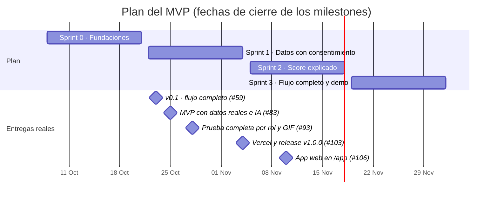

# Planificación

El MVP se planeó en cuatro sprints de dos semanas, con 50 historias (`TND-XXX`) agrupadas en nueve épicas. Todo vive en los [issues](https://github.com/TendIA-IETI-Team/tendia/issues) y en los [milestones](https://github.com/TendIA-IETI-Team/tendia/milestones) del repositorio.

## Cronograma

El alcance se entregó antes de lo planeado: el flujo completo T1 a T13 y A1 a A4 quedó listo en la tercera semana. El tiempo restante se usó en datos reales, la prueba de usabilidad, la prueba completa por rol y el despliegue.

## Sprints

| Sprint                       | Objetivo                                                                                                           | Historias             | Entregable                                        |
| ---------------------------- | ------------------------------------------------------------------------------------------------------------------ | --------------------- | ------------------------------------------------- |
| 0 · Fundaciones              | Monorepo, CI, ADR, modelo de datos, ambientes y mockups de alta fidelidad                                          | 6 (TND-001 a TND-006) | Repositorio con CI y arquitectura decidida        |
| 1 · Datos con consentimiento | Ingreso con OTP, roles y aislamiento, consentimiento (Ley 1581), conectores simulados, dataset y solicitud T1      | 10                    | El tendero entra, pide crédito y autoriza fuentes |
| 2 · Score explicado          | MFA del aliado, validación de datos, variables, scorecard, `/score`, T4 a T9 y la bandeja A1                       | 11                    | Puntaje explicado con IA que llega al portal      |
| 3 · Flujo completo y demo    | Revocar, bitácora, Open Finance, T5, cuaderno, T8 a T13, política, A2 a A4, API pública, OWASP, usabilidad y pitch | 23                    | El flujo de punta a punta, probado con tenderos   |

## Épicas

| Épica | Tema                                            |
| ----- | ----------------------------------------------- |
| E0    | Fundaciones del proyecto                        |
| E1    | Identidad y acceso                              |
| E2    | Consentimiento y protección de datos (Ley 1581) |
| E3    | Ingesta de datos del negocio                    |
| E4    | Motor de scoring                                |
| E5    | App del tendero                                 |
| E6    | Portal del aliado y API de score                |
| E7    | Calidad, seguridad y observabilidad             |
| E8    | Validación con usuarios y customer success      |

## Equipo y responsabilidades

| Persona           | Rol                         | Responde por                               |
| ----------------- | --------------------------- | ------------------------------------------ |
| Andersson Sánchez | QA & Data/ML Lead           | Calidad, CI, datos y modelo, despliegue    |
| Cristian Pedraza  | Backend Developer           | API, seguridad, arquitectura               |
| David Villadiego  | Data Scientist              | Variables, scorecard y model card          |
| David Sarria      | Product & Business Strategy | Producto, modelo de negocio y pitch        |
| Juan Lozano       | UX/UI & Wireframes          | Wireframes, mockups y prueba de usabilidad |
| Raquel Selma      | Documentation & QA          | Documentación, legal y pruebas             |

## Cómo trabajamos

- Scrum con sprints de dos semanas; cada sprint es un milestone y cada historia un issue con prioridad MoSCoW (`must`, `should`, `could`) y área.
- Ramas `feature/TND-XXX-descripcion`, Conventional Commits y PR a `main` con al menos una aprobación.
- Definition of Done en la plantilla de PR: pruebas verdes, cobertura de al menos 70 % en API y scoring, documentación actualizada y sin datos personales en logs.
- Cada fusión a `main` despliega sola en Vercel.

## Riesgos

| Riesgo                                                   | Impacto                                           | Mitigación                                                                                         |
| -------------------------------------------------------- | ------------------------------------------------- | -------------------------------------------------------------------------------------------------- |
| No hay convenios con proveedores de datos                | No hay datos reales del tendero                   | Conectores simulados con EMICRON detrás de una interfaz común; cambiar a uno real no toca el resto |
| El componente de negocio se calibró con datos sintéticos | El puntaje puede no predecir igual en la realidad | Validarlo con los pagos del piloto; reentrenar si el Gini baja más de 0,05                         |
| La IA dice algo indebido ("aprobado")                    | Promesa falsa al tendero                          | La IA solo redacta; filtro de frases prohibidas y plantilla de respaldo                            |
| Caídas de Claude o Twilio                                | Sin explicación o sin códigos                     | Tiempos límite, plantillas y reglas de respaldo                                                    |
| Uso comercial en planes gratuitos                        | Vercel Hobby no admite uso comercial              | Pasar a planes pagos al primer cliente ([plan de infraestructura](diseno/plan-infraestructura.md)) |
| Exigencias de un banco vigilado                          | Red privada, alta disponibilidad, llaves propias  | Fase 3 del plan: migrar a AWS con el mismo código                                                  |

## Modelo financiero

Resumen del modelo a 36 meses (archivo _Modelo Financiero TendIA 36M - IETI.xlsx_, en pesos colombianos):

| Supuesto o resultado               | Valor                                                                                         |
| ---------------------------------- | --------------------------------------------------------------------------------------------- |
| Plan mensual por entidad           | $1.800.000 con 500 puntajes incluidos                                                         |
| Puntaje adicional                  | $3.500                                                                                        |
| Costo por puntaje                  | $1.075 (el 89 % son datos externos; la IA pura cuesta $115)                                   |
| Clientes                           | 10 en el mes 1, ~16 al cierre del año 1, ~28 del año 2 y ~47 en el mes 36 (4,5 % neto al mes) |
| Puntajes al mes                    | 7.000 en el mes 1 y ~32.700 en el mes 36                                                      |
| Margen de contribución por cliente | ~70 %                                                                                         |
| Punto de equilibrio operativo      | Mes 5                                                                                         |
| Ingresos en 36 meses               | ~$2.281 millones ($387M, $684M y $1.211M por año)                                             |
| Utilidad operativa en 36 meses     | ~$545 millones                                                                                |
| Capital inicial                    | $60 millones (socios y capital semilla)                                                       |
| Caja mínima                        | ~$39,7 millones en el mes 5                                                                   |
| LTV / CAC                          | ~17× (optimista: el churn de 2 % mensual aún no está validado)                                |
| Infraestructura fija               | $2,5M al mes el año 1, $3,25M el año 2 y $4,23M el año 3                                      |
