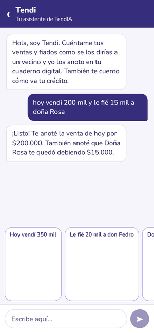
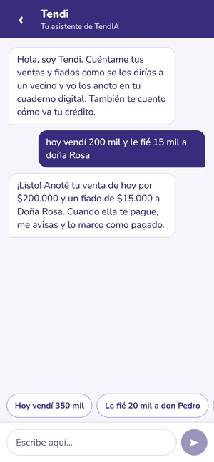
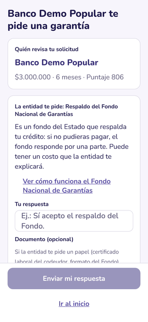
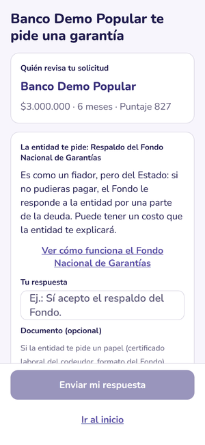

# Prueba de usabilidad del MVP con tenderos (TND-080)

> **Estado (25 oct 2026):** el guion está listo y se ejecutó una **evaluación de usabilidad sin usuarios** sobre la app real: recorrido de las 9 tareas, modelo KLM, revisión heurística y de accesibilidad. Los 11 hallazgos se corrigieron en el mismo PR. Ver [Resultados](#resultados-de-la-evaluación-sin-usuarios-25-oct-2026). Doña Gloria participó en la primera prueba, la que definió T2, T5, T7 y T9. Las sesiones con 3 a 5 tenderos usan este mismo guion y su plantilla.

Objetivo: saber dónde se confunden 3 a 5 tenderos antes de la entrega, con el MVP real en un celular. La primera prueba, con doña Gloria (Kennedy), cambió T2, T5, T7 y T9: tres franjas en vez de cinco niveles, "lo que tú nos cuentas" en vez de "auto-reportado", y quién revisa en vez de "en revisión".

## Participantes

| #   | Perfil                                                        | Cómo llegar                           | Celular de prueba               |
| --- | ------------------------------------------------------------- | ------------------------------------- | ------------------------------- |
| 1   | Doña Gloria, tienda en Kennedy, anota en cuaderno (si acepta) | Contacto de la primera prueba         | `300 000 0002` (caída en enero) |
| 2   | Tendero con datáfono                                          | Barrio de algún integrante del equipo | `300 000 0001`                  |
| 3   | Tendero sin datáfono, negocio de menos de 1 año               | Barrio de algún integrante del equipo | `300 000 0004`                  |
| 4-5 | Opcional: minimercado y tienda de un pueblo cercano           | Referidos                             | `300 000 0005` a `300 000 0999` |

Antes de empezar: leer el consentimiento de la prueba, aclarar que **no es un crédito real** y que se puede parar en cualquier momento. No se graba la cara ni se guardan datos reales: solo los celulares de prueba.

## Tareas

Se dice la tarea en voz alta y no se ayuda. Si pasan 2 minutos sin avanzar, se da una pista y se anota.

| #   | Tarea (lo que se le dice)                                                                            | Pantallas          | Éxito                                          |
| --- | ---------------------------------------------------------------------------------------------------- | ------------------ | ---------------------------------------------- |
| 1   | "Entra a la app con este celular."                                                                   | Ingreso, OTP       | Llega al inicio                                |
| 2   | "Pide 3 millones para surtir la tienda, a 6 meses."                                                  | T1                 | Solicitud creada                               |
| 3   | "Deja que TendIA vea tus ventas del datáfono y tus pagos al proveedor, pero no tu cuenta del banco." | T2                 | Autoriza solo esas dos fuentes                 |
| 4   | "¿Cómo te fue? ¿Es bueno o malo tu puntaje? ¿Por qué?"                                               | T7                 | Explica la franja y un factor con sus palabras |
| 5   | "En enero vendiste poco por unas obras. Cuéntaselo a TendIA."                                        | T8                 | Justifica enero y ve el recálculo              |
| 6   | "Anota con Tendi que hoy vendiste 200 mil y le fiaste 15 mil a doña Rosa."                           | Asistente          | Ambas cosas quedan en "Mi cuaderno"            |
| 7   | "Manda tu solicitud al Banco Demo Popular."                                                          | T9                 | Sabe quién la revisa                           |
| 8   | (El facilitador pide garantía desde el portal.) "Te llegó algo. ¿Qué te piden y qué es eso?"         | Aviso, T10         | Explica el FNG o el codeudor como un respaldo  |
| 9   | "Quita el permiso del datáfono."                                                                     | Mis autorizaciones | Revoca y entiende que se borran esos datos     |

## Métricas por tarea

- **Completada:** sí, con pista o no.
- **Tiempo:** desde que se dice la tarea hasta el éxito.
- **Dudas:** cada vez que pregunta, duda más de 5 segundos o toca algo equivocado. Anotar la palabra o el botón.
- **Al final:** "Del 1 al 5, ¿qué tan fácil fue?" (la misma pregunta de la app, TND-081) y "¿Se lo recomendarías a otro tendero? ¿Por qué?".

## Plantilla de registro

| Participante | Tarea | Completada | Tiempo | Dudas (textual) | Gravedad (1 a 3) |
| ------------ | ----- | ---------- | ------ | --------------- | ---------------- |
|              |       |            |        |                 |                  |

Gravedad: **1** se recupera sola, **2** necesita pista, **3** abandona.

## Después de la prueba

1. Unir los registros en una tabla y contar cuántos participantes tuvieron cada problema.
2. Cada problema de gravedad 2 o 3, o que le pase a 2 o más personas, se abre como issue con la etiqueta `research`, la pantalla (T1 a T13), la cita textual y la propuesta de cambio.
3. Resumir los hallazgos y los issues creados como comentario en TND-080, y agregar una sección "Validación con usuarios" al README.

## Resultados de la evaluación sin usuarios (25 oct 2026)

**Método.** Un script ([`apps/portal/scripts/recorrido-usabilidad.js`](../apps/portal/scripts/recorrido-usabilidad.js)) hace las 9 tareas en la app real (Expo web, 390 × 844 px, API y Claude reales) y registra:

- **Pasos:** los toques y lo que se escribe.
- **Tiempo estimado** con el modelo KLM (Card, Moran y Newell), ajustado a un usuario novato: 2,0 s para decidir, 1,1 s para apuntar, 0,6 s por letra y lectura en diagonal de la pantalla.
- **Accesibilidad:** axe-core en cada pantalla.
- **Tamaños mínimos:** objetivos táctiles de 44 × 44 px y letra de 14 px.
- **Heurísticas de Nielsen,** revisadas pantalla por pantalla.

No reemplaza ver a un tendero usando la app, pero encuentra los problemas que no dependen de él.

### Tareas

| #   | Tarea                                   | Completada | Pasos  | Tiempo estimado (novato) | Nota                                                                   |
| --- | --------------------------------------- | ---------- | ------ | ------------------------ | ---------------------------------------------------------------------- |
| 1   | Entrar con el celular                   | ✅         | 4      | 28 s                     |                                                                        |
| 2   | Pedir 3 millones para surtir, a 6 meses | ✅         | 6      | 29 s                     | Antes, "Siguiente" se quedaba gris sin decir que faltaba la antigüedad |
| 3   | Autorizar datáfono y proveedor          | ✅         | 3      | 21 s                     |                                                                        |
| 4   | Decir si el puntaje es bueno y por qué  | ✅         | 0      | 20 s                     | Franja y motivo visibles sin desplazarse                               |
| 5   | Justificar un mes malo                  | ✅         | 4      | 17 s                     | Muestra cuántos puntos subió                                           |
| 6   | Anotar con Tendi una venta y un fiado   | ✅         | 5      | 51 s                     | La tarea más larga: escribir el mensaje. Las sugerencias la acortan    |
| 7   | Enviar al Banco Demo Popular            | ✅         | 5      | 19 s                     | Ve quién revisa                                                        |
| 8   | Entender la garantía que piden          | ✅         | 1      | 15 s                     | Antes no comparaba el FNG con un fiador                                |
| 9   | Quitar el permiso del datáfono          | ✅         | 4      | 19 s                     | Antes de confirmar dice que se borran los datos                        |
|     | **Total**                               | **9 de 9** | **32** | **≈ 3 min 40 s**         |                                                                        |

### Hallazgos y arreglos

| #   | Hallazgo                                                                                                  | Heurística o norma                                          | Gravedad | Arreglo                                                                                   |
| --- | --------------------------------------------------------------------------------------------------------- | ----------------------------------------------------------- | -------- | ----------------------------------------------------------------------------------------- |
| 1   | "Siguiente" deshabilitado en T1 sin decir qué falta (la antigüedad queda abajo, fuera de la vista)        | Nielsen 1 y 9: visibilidad del estado, ayudar a recuperarse | 2        | Texto "Falta: …" sobre el botón                                                           |
| 2   | Desde el puntaje no hay forma visible de volver al inicio (solo el gesto de atrás)                        | Nielsen 3: control y libertad                               | 2        | Enlace "Ir al inicio"                                                                     |
| 3   | El FNG no se explicaba como un fiador (lo pide TND-056)                                                   | Nielsen 2: lenguaje del usuario                             | 2        | "Es como un fiador, pero del Estado…"                                                     |
| 4   | Las sugerencias del chat de Tendi se estiraban a ~180 px de alto y tapaban la conversación                | Nielsen 8: diseño minimalista                               | 2        | `flexGrow: 0` y alto mínimo de 44 px                                                      |
| 5   | Chips, fuentes y entidades sin `aria-checked`: el lector de pantalla no dice cuál está elegida (31 casos) | WCAG 4.1.2 (axe, crítico)                                   | 2        | `aria-checked` en los tres componentes                                                    |
| 6   | La barra de pasos usaba `aria-label` en un `div` sin rol (5 casos)                                        | WCAG 4.1.2 (axe, serio)                                     | 1        | Rol `progressbar` con valor "Paso n de 4"                                                 |
| 7   | Texto verde de éxito sobre su fondo: 4,39:1, y advertencia 4,34:1 (mínimo 4,5:1)                          | WCAG 1.4.3 (axe, serio)                                     | 1        | `success` #1B7346 (5,15:1) y `warning` #875A00 (5,36:1), con pruebas en `packages/tokens` |
| 8   | Botón "‹" para volver en Tendi de 10 × 36 px y "Ya pagó" de 52 × 19 px                                    | WCAG 2.5.5, guías de Apple y Material (44 px)               | 2        | Áreas de toque de 44 × 44 px                                                              |
| 9   | Aviso de versión de prueba en T2 con letra de 13 px                                                       | Legibilidad para personas mayores (mínimo 14 px)            | 1        | 15 px                                                                                     |
| 10  | En "Mi cuaderno" el resumen de ventas y fiados quedaba debajo de la foto, fuera de la vista               | Nielsen 6: reconocer antes que recordar                     | 1        | El resumen va primero                                                                     |
| 11  | Texto de botones partido en dos líneas y alineado a la izquierda ("Hablar con Tendi")                     | Nielsen 4: consistencia                                     | 1        | Texto centrado                                                                            |

Gravedad: **1** cosmético, **2** dificulta la tarea, **3** la impide. No hubo de gravedad 3.

**Después de los arreglos:** 9 de 9 tareas completadas, 0 hallazgos críticos o serios de axe y 0 objetivos táctiles menores de 44 px. Quedan dos avisos que solo existen en la versión web de React Native y no aplican a la app en el celular: zona de desplazamiento sin foco de teclado, y contenido fuera de landmarks.

<table>
  <tr>
    <td align="center"> Antes: sugerencias estiradas</td>
    <td align="center"> Después</td>
    <td align="center"> Antes: FNG sin "fiador"</td>
    <td align="center"> Después</td>
  </tr>
</table>

### Qué solo pueden responder los tenderos

Las sesiones con personas siguen siendo la forma de validar lo que una evaluación sin usuarios no ve: si entienden "franja" y "fiado" escritos en la app, si confían en autorizar el datáfono, y si prefieren Tendi o el formulario. Para eso está el guion de arriba: cada hallazgo de gravedad 2 o 3 se abre como issue con la etiqueta `research`.
